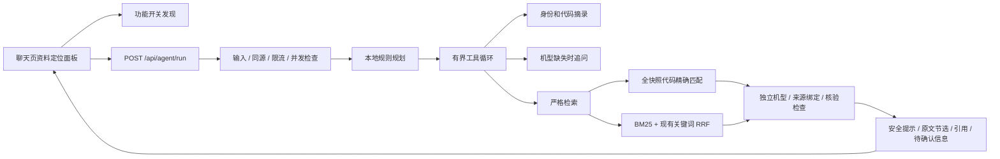

# Agent 工作流架构与实现边界

当前交付是一条可端到端运行、默认关闭的**严格资料定位工作流**，提供器为本地确定性规则。它不等同于原始阶段 0–13 的完整诊断体系，也未调用 LLM。

- `shared/agent.ts` 是前后端协议；`agent/core/workflow.ts` 负责规则流程、来源结果和追问；`agent/core/loop.ts` 提供可替换的 Provider 接口、步骤/调用/上下文/时间预算、只读并行、重复调用与无进展终止、取消和状态事件。
- `agent/runtime/registry.ts` 保留工具统一契约，支持 OpenAI/Anthropic schema、参数校验、任务缓存、分页、角色权限、可信宿主确认和写操作审计。原有 `agent/tools.ts` 保持兼容；当前 HTTP 入口仅绑定四个只读工具，不暴露任意工具执行、角色、确认、文件或配置修改。
- `agent/retrieval/strict.ts` 在现有快照上工作。代码通道绕过症状关键词排名，扫描本代全部条目；当前归档加载后尚无结构化故障码或发动机适配字段，代码/发动机约束查询会明确提示缺口，不猜含义；普通通道融合 BM25 与原有关键词排名。每个结果独立核对来源绑定、资料核验、品牌型号和声明适用范围。归档加载器校验并传递条目级 engine_model / fault_codes，不继承整册代码清单。故障码从身份解析文本中移除，避免误识别成另一个型号。词典在 `data/agent-glossary.json`，只表达现象同义词。
- 当前没有向量召回、Embedding/Rerank 厂商适配、交叉编码重排、年份/手册多版本自动选择或已验证因果图谱。所有结果标记证据“部分”与低置信度；展示节选并保留出处及适用范围，不生成新的维修步骤、参数或故障原因。
- `agent/ingest/index.ts` 是独立暂存器，验证元数据、保留 Markdown 表格/代码块、按章节切块，并通过完整快照检测版本内容变化与移除；它尚未把新文档送入生产知识索引。PDF/Word/OCR 和步骤级切分未实现。
- `agent/prompts/` 按任务读取固定可信文件并记录版本；规则提供器的安全校验由代码强制，不依赖模型服从提示词。暂未有使用这些提示词的外部模型提供器。
- 前端通过 SSE 在独立可滚动弹窗中展示工具状态、可折叠原文引用、追问选项、停止与失败重试；导出的是本次执行状态 JSON。未接入写操作确认弹窗、图谱/场景定位或图片分析。
- 执行结果不自动持久保存；现有 `/api/chat` 诊断记忆仍归原有所有权校验管理。新工作流没有长期记忆工具，不把用户报告升级为核验事实。
- HTTP 层每分钟 30 次/IP、最多 2 个同时运行；核心默认 8 步、16 次调用、60 秒和 64000 字符工具上下文。同步 JavaScript 不能被计时器硬抢占；异步取消只停止等待并发出信号。写操作超时后禁止自动重试。
- 状态 trace 只包含工具名、耗时、状态和错误码；不保存问题、个人身份、凭据或私有模型推理。`WorkflowMetrics` 仅保留累计计数与最近 256 次耗时，暂未提供监控页面或跨进程持久指标。
