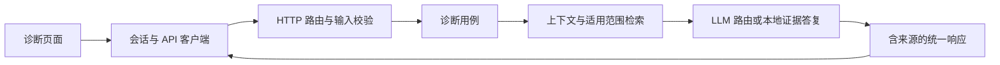
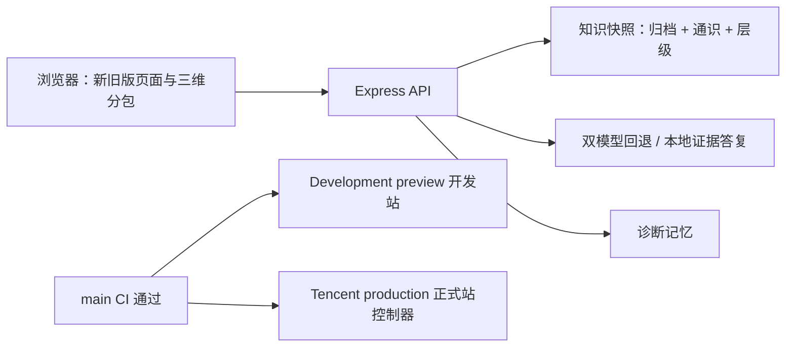
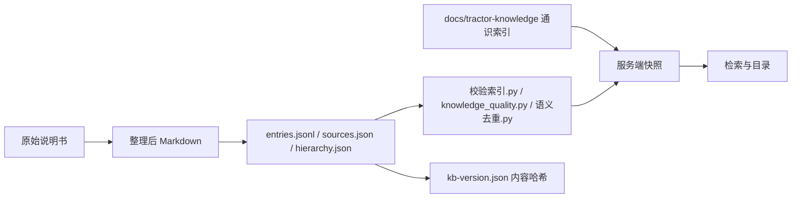
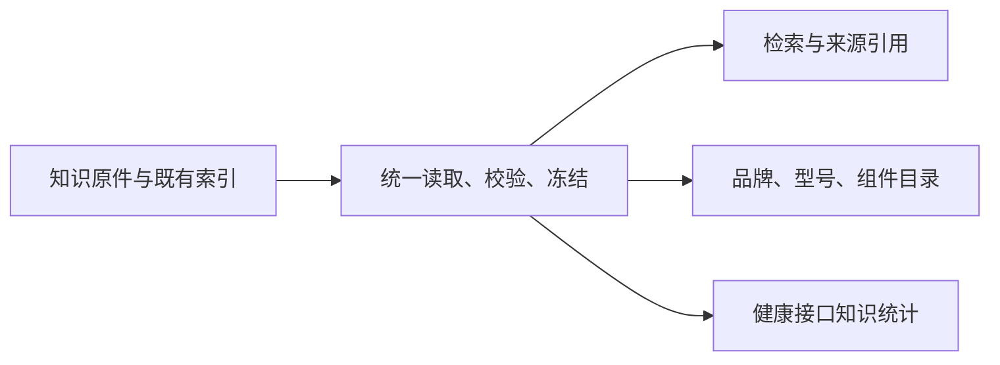

# v3 架构与维护

> 核对于 3.7.3 / 2026-10-21。改动模块边界（新增 `server/`、`src/features/`、`src/pages/` 顶层目录或新的数据链路）须同步更新本文档。

项目保留 React/Vite/Express 和现有本地知识检索、双模型回退。3.0.1 将界面、请求边界、诊断用例、外部模型与运行初始化拆开，便于协作者独立修改和验证。

## 模块职责

| 位置 | 职责 |
| --- | --- |
| `src/pages/` | 路由页面、布局、文案与交互呈现 |
| `src/features/chat/` | 会话状态、请求生命周期、历史存储、健康状态 |
| `src/features/knowledge/catalog-api.ts` | 知识目录请求与响应解析 |
| `src/lib/api-client.ts` | HTTP/JSON 边界、错误与 AbortSignal |
| `shared/chat.ts`、`shared/knowledge-catalog.ts` | 前后端协议纯类型，不导入服务端实现或密钥 |
| `server/app.ts` | 注入运行依赖，装配 Express 与 API；每个实例独立限流状态 |
| `server/routes/` | HTTP 路由、请求参数与响应状态，不承担模型回退算法 |
| `server/diagnosis/` | 对话输入校验，协调上下文、知识检索、提示词与模型/本地答复 |
| `server/knowledge/` | 原有索引、适用范围过滤、多轮上下文、目录和证据回复 |
| `server/llm/` | 供应商协议、配置、超时和双模型顺序回退 |
| `server/memory/` | 诊断记忆的上下文、存储与路由（见[诊断记忆](diagnostic-memory.md)） |
| `src/features/updates/` | 客户端版本检查与自动更新提示（见[自动更新](deployment/automatic-client-update.md)） |
| `src/pages/HallPage/`、`ExhibitionPage/`、`HomePage/`、`ModelPage/` | 数字展厅、园区首页与模型工坊；三维场景经 `DeferredScene` 延迟加载，WebGL 不可用时回退 `SceneFallback` |
| `server/config/`、`server/runtime.ts` | 读取环境、初始化知识索引与运行依赖 |
| `server/http/` | 安全头、限流、JSON 错误、前端托管及监听/退出 |
| `scripts/` | 跨平台检查、构建、测试和已提交工作分支同步 |

## 请求链路



页面只调用前端客户端，不直接引用 `server/`。协议类型放在 `shared/`；浏览器接收的数据仍需运行时校验，TypeScript 类型不能替代输入验证。会话恢复沿用原存储键，跳过未完成的 loading/error 消息；发送保留最多 20 条历史，用户问题上限 2,000 字。取消等待与清空会话使旧请求失效，不让迟到的响应污染新对话。

HTTP 路由只做传输边界；诊断用例保留来源编号、定位、手册版本与适用范围，不将模型通用分析或品牌匹配当作确诊。知识原件和索引不随架构整理改写；修改知识时继续遵守其目录规范。

3.6.0 的 `server/diagnosis/router.ts` 在一次已完成的检索结果上执行无副作用决策；`service.ts` 复用结果生成本地或 AI 答复。覆盖标签与检索文本在知识导入时计算，短期缓存只保存公开静态片段；来源、限制和正文按完整块计入上下文预算。安全降级、必要追问、可靠来源和原始分数的边界及性能验收见[诊断路由说明](diagnosis-router.md)。

## 系统上下文



前端三维依赖由 `vite.config.ts` 拆为 `three`、`r3f` 与 `postfx` 分包；辉光仅宽屏且未开启减少动态时加载。

## 知识数据链路



`kb-version.json` 记录知识库独立版本（`YYYY.MM.N`）与内容哈希，`npm run verify` 校验；`/api/knowledge/catalog` 返回 `kbVersion`。语义去重（`语义去重.py`）只出候选报告，`语义预审.py` 做模板折叠、分级与可选离线 AI 预审，人工决定写入 `dedup-review.jsonl`，工具不删除、不改写条目。详见[统一知识目录](knowledge-library.md)、[知识质量](knowledge-quality.md)、[语义候选](knowledge-semantic.md)。

## 版本与发布链路

`npm run version:update` 同步项目版本、批次与 CHANGELOG 骨架；`check:version` 校验一致性、3.8.0 上限及最新日志节的批次 ID、更新类型与验证。知识内容变化另运行 `node scripts/kb-version.mjs --bump`。PR 合入 main 且 CI 通过后，开发站与腾讯正式站按[开发预览](deployment/dev-preview.md)与[腾讯主干同步](deployment/tencent-production-sync.md)更新；部署结果单独验收。规则见[版本规则](version-policy.md)。

## 初始化与入口

### 共享知识快照

`server/knowledge/snapshot.ts` 是生产知识初始化的统一入口。它一次读取通用 Markdown、归档条目、通识学习资料、来源记录和层级索引，完成全部校验后发布只读快照。`retriever.ts` 的检索和统计、`catalog.ts` 的目录均使用该快照；先调用任一加载入口，后续初始化调用都复用已验证数据，不再重复读取正文和索引。`catalog-data.ts` 只负责从已加载数据构造目录，不执行文件读取。3.5.4起，6000条学习资料与4853条归档共同在知识页搜索和分页浏览。3.10.0起（用户2026-10-22决定），问题未指定品牌／型号时归档与通识统一检索，通识以“通识（无手册页码）”作为证据；指定品牌／型号时只检索匹配归档、不用通识，详见[统一知识目录](knowledge-library.md#通识tk作为证据的检索范围用户2026-10-22决定)；累计和分类口径见[统一知识目录](knowledge-library.md)。



`loadKnowledgeBase()`、`loadKnowledgeCatalog()`、`getKnowledgeCatalog()`、`retrieve()` 和 `stats()` 保留原有调用入口。目录的 `totals.entries` 现在统计归档与学习合计，并增加两类分项；健康统计保留原归档/检索计数，新增学习数与合计。型号、配置、排放范围、来源编号、章节定位和手册版本继续使用原数据与原筛选规则。快照和返回的目录数据被冻结，防止调用者修改缓存证据。

需要进程内重新读取时，显式调用 `reloadKnowledgeSnapshot()`。只有全部读取和校验成功后，才一起切换检索、目录、统计与型号识别；失败会抛出异常并保留上一份可用快照。首次读取失败则阻止初始化，避免提供部分知识。通用 Markdown 的读取错误也按此规则处理，不再跳过损坏文件。独立 `loadArchive()` 默认仍配置型号以保留兼容性；生产消费者应使用快照，隔离测试可传入 `{ configureModels: false }`。

`tests/knowledge-snapshot.test.ts` 验证重复入口的读取次数、证据和目录只读保护、配置隔离、重载成功整体切换及失败时的数据与型号识别回退。浏览器开发预览继续使用既有文件系统替代实现，无新增生产接口。

`server.ts` 是 `npm run dev` / `npm start` 共用入口，依次创建运行依赖、装配 API、挂载开发 Vite 或生产静态前端，再监听端口。初始化读取既有进程环境、根 `.env`、`server/.env`，配置代理后再构造模型实例。健康状态只表明配置是否存在，不表示上游鉴权或连接通过。

`server/app.ts` 的工厂可用于注入本地测试依赖；导入它不读取环境文件、不加载知识库、不监听端口。`server/index.ts` 保留默认 API app 兼容现有调用；直接执行 index/dev 仍提供 API 服务。未知 `/api` 返回 JSON 404，其他页面路径仍使用原有前端兜底。

服务从仓库根目录运行，继续通过 `tsx server.ts` 启动。`build:server` 的 `dist-server/` 是 TypeScript 编译验证产物，未切换到编译 JS 的生产入口。线上部署仍按已有资料另行验收；本轮仅本地检查和 GitHub 工作分支保存。

## 开发与检查

推荐 Node 24（`.node-version`），最低 Node 22.19.0，npm 10 及以上。Windows PowerShell 用 `npm.cmd`。

```powershell
npm.cmd ci
npm.cmd run dev
npm.cmd run verify
```

`verify` 依次检查 package/lockfile/README/最新日志版本、知识库版本哈希、前后端与 Vite 配置类型、全部回归测试、Lint 和完整前后端构建；任一步失败即停止。`build` 同时构建前端与后端；保留 `build:client`、`build:server`、`test`、`typecheck` 和 `lint` 单独入口。构建与测试明确调用本地 Node CLI，无需 Bash 或 PATH 中的 vite/tsx。

锁文件补齐各平台可选依赖，现有依赖版本保持。如果本机镜像元数据不全，使用 `npm.cmd ci --registry=https://registry.npmjs.org` 完成本次安装；不修改用户全局 npm 设置。

CI 在 Ubuntu 与 Windows 分别运行相同 `verify`，`ci-verify` 汇总两边结果。它仅持有源码读取权限，不合并 PR、不创建标签或 Release、不部署，也不修改已有仓库规则。

## 协作与同步

从最新 main 建 `codex/` 工作分支；修改后检查 diff，只提交任务文件，版本与日志按最终范围同步。完成提交且工作区干净后运行：

```powershell
npm.cmd run sync
```

同步拒绝 main/master/远端默认分支和 detached HEAD，明确禁用附带标签；不会自动暂存、提交、拉取覆盖或部署。旧 `bash scripts/build.sh` 与 `bash scripts/sync.sh` 转发到同一 Node 实现。暂停的 `cloud-pull.sh` 明确退出，历史服务器准备脚本仅保留作资料，不安排执行。合入前按[贡献指南](../CONTRIBUTING.md)审阅 PR。
