# 新版界面 · 2026-10-21

项目版本 **3.6.0**（批次 `hall-20261020-digital-twin`）。新版是默认界面；顶栏开关可以回到旧版。本文说明这套界面的颜色、共用样式和主要交互。截图来自本分支开发核对（无头 Chrome、SwiftShader），对应文件在同目录。

知识索引、品牌字段和目录协议不在这套界面改动里。展厅运行环和设备表是示例数据，目录条数来自现有知识目录接口。

## 两套界面怎么分

| | 新版 | 旧版 |
| --- | --- | --- |
| 开关 | `agridx-ui-version=new`（默认） | 同一开关切到 `old` |
| 首页 | 园区 `/#/`，页面自带顶栏 | 经典首页 |
| 内页 | `NewVersionShell`：知识目录、模型工坊、智能诊断、数字展厅 | 经典布局 |
| 未知地址 | 麦穗线、五个去向、底部状态条 | 「已被移除」，按钮是「返回首页」 |
| 研究依据 | 园区第四展亭切回旧版，并滚到研究章节 | 首页研究章节 |

主题存在 `srt-theme`，语言存在 `srt-lang`。深色类名是 `theme-dark`。

## 颜色和共用样式

枢纽色写在 `src/tailwind-theme.css` 的 `--hub-*`。浅色底是 `#f4f7fa`，深色底是 `#111820`，深色主色是 `#a3d4ec`。

数字展厅的深色另有一组名字，避免青蓝色散落在各处：

| 令牌 | 值 | 用途 |
| --- | --- | --- |
| `--hall-night` | `#07131d` | 展厅夜色底 |
| `--hall-surface` | `#10283a` | 展厅表面 |
| `--hall-card` | `#0e2233` | 展厅卡片 |
| `--hall-cyan` | `#7ad7ff` | 展厅青蓝 |
| `--hall-line` | `#1a5674` | 展厅分隔线 |

只在 `html.theme-dark .hall-page` 里用这组值覆盖 `--hub-*`。浅色展厅继续用枢纽色。

`src/new-version-tokens.css` 收拢园区、外壳和展厅原先各写一份的规则：

- 三处页面的盒模型
- 园区和外壳的链接色、点击高亮、焦点环（展厅焦点仍用 `--hub-primary`，写在 `hall.css`）
- `.nv-corners`：面板四角标线
- `.nv-example`：「示例数据」胶囊

麦穗线在 `src/wheat-motif.css`。园区顶栏和外壳顶栏共用一条 `::after`。新版 Lucide 图标描边是 1.5。

动效时长只在 `src/lib/motion-tokens.ts` 定义一次：按压 160ms、悬停 220ms、入场 520ms、升起 640ms。样式和三维缓动都读这些变量。开启「减少动态」后，入场、扫描、片头、自转和视图过渡都停掉。

## 页面与状态条

底部状态条写明 AGRIDX、工学院和当前所在。位置文案由 `statusPlace` 决定：

| 路径 | 中文 | 英文 |
| --- | --- | --- |
| `/` | 园区 | CAMPUS |
| `/hall` | 数字展厅 | DIGITAL HALL |
| `/knowledge` | 知识目录 | CATALOG |
| `/models` | 模型工坊 | MODEL STUDIO |
| `/chat` | 智能诊断 | DIAGNOSIS |
| 其他 | 未找到 | NOT FOUND |

园区上的状态条宽度跟原来的页脚一致，最宽 1800px。诊断页外壳锁在 `100dvh`，状态条留在视口里。

## 交互

### 数字展厅 `/#/hall`

左栏 A–D 与中央等轴大厅同步。打开时镜头停在整厅总览，四个展区都在画面里。点选展区或按方向键后才飞近该区，到头后折返（`adjacentHallZone`）。点选后左侧抽屉列出该区三台机具（`devicesInZone`），Esc 或关闭按钮收起。大厅是夜色，分区地面发光；辉光只接住较亮的边缘，避免把画面冲白。

十二台机具写在 `hall-example-data.ts`：在线 8、待机 2、维护 1、离线 1。面板上的胶囊是 `exampleDataLabel`：中文「示例数据」，英文 Example data。规格前缀同样是「示例 / Example」。展厅概况的条数、品牌和型号只来自 `useKnowledgeCatalog()`，加载或失败时显示「—」。文案保留监测边界：传感器与实车孪生未接入。环上的 12 台是示例，不是在线机队。

抽屉里的「查看该展区资料」进入知识目录。支持视图过渡的浏览器会把展区名称过渡到目录标题。

中央机具是低模程序模型：拖拉机有驾驶室、车轮和排气管，收获机有割台和拨禾轮，播种机有种箱，无人机有四旋翼，监测小车有传感器。地面读取房间环境作为反射，并叠一层按展位烘焙的接触暗部。状态光环颜色与设备表一致。在线机具有旋转信标，在线与维护中的收获机拨禾轮缓转。示例无人机仍标离线，没有信标；「机具动态」打开时它的旋翼转动并轻微悬停。这圈动态约每 120 毫秒一帧，按钮可暂停。标签页隐藏或系统减少动态时不再调度。暂停后回到 `frameloop="demand"`，镜头停稳不再持续重绘。窄屏与减少动态不加辉光。

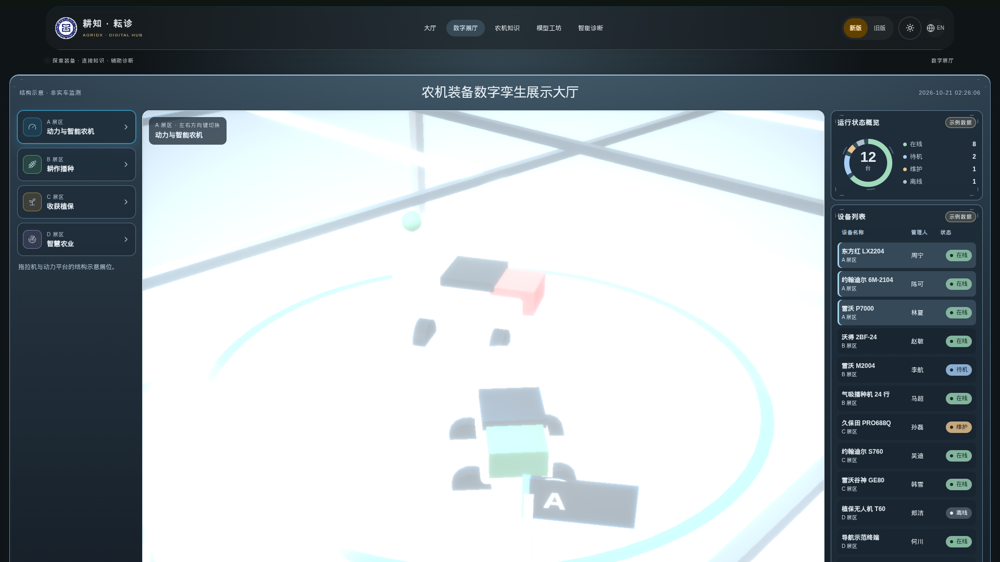

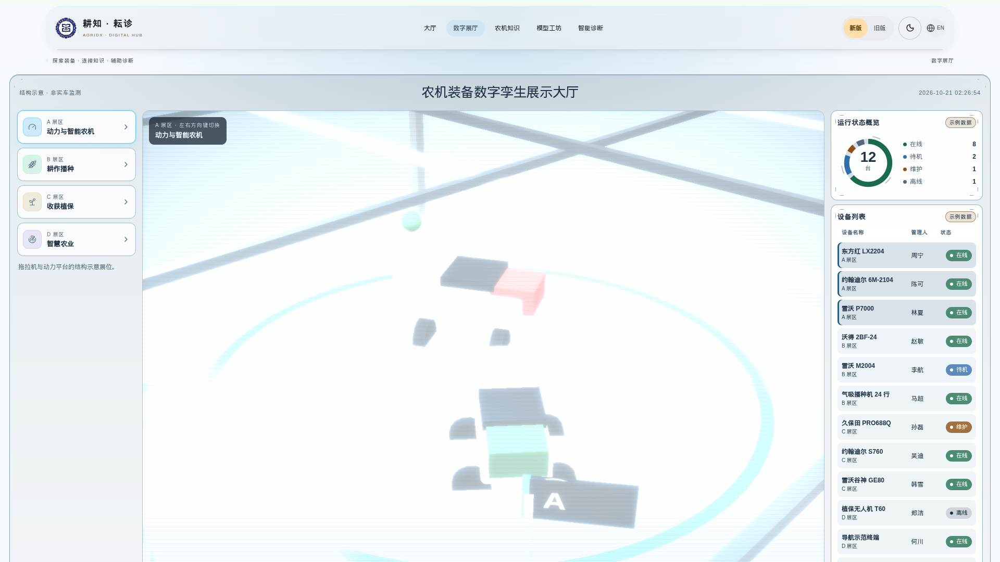

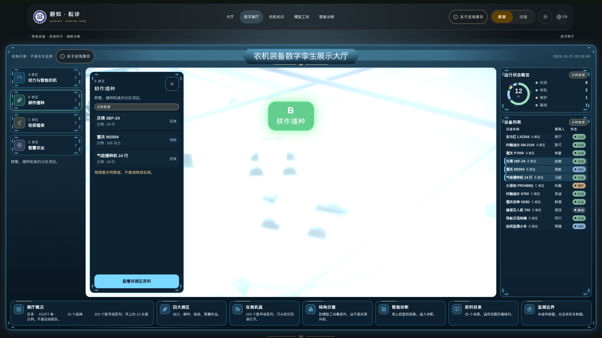

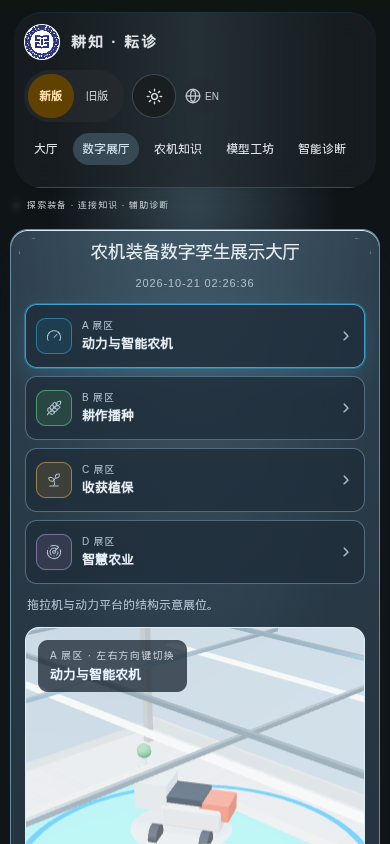

### 园区 `/#/`

四个展亭对应知识、诊断、模型工坊和研究依据。前三个打开新版页面，路径由 `pavilionDestination` 决定：

| 展亭 | 路径 | 过渡名 |
| --- | --- | --- |
| 农机知识 | `/knowledge` | `pavilion-knowledge` |
| 智能诊断 | `/chat` | `pavilion-diagnosis` |
| 模型工坊 | `/models` | `pavilion-models` |
| 研究依据 | 切回旧版首页研究章节 | 无 |

第一次打开新版时，前约 4.8 秒只留一件事：镜头从高处落下，画面中央的标题在 1.4 秒内揭开，麦穗线跟着画出。导览、查找资料和坐标先让开。页眉标题在大约 3 秒时接上。时间到了，「开始漫游」和四个展区再进来。跳过或 Esc 会立刻结束，并记在 `sessionStorage` 的 `agridx-campus-intro`。同一会话不再重播。减少动态不播放这段。时长写在 `intro-timing.ts`。

WebGL 不可用或上下文中断时，画面换成静态平面示意，展亭按钮仍然可点，三维分包不再下载。

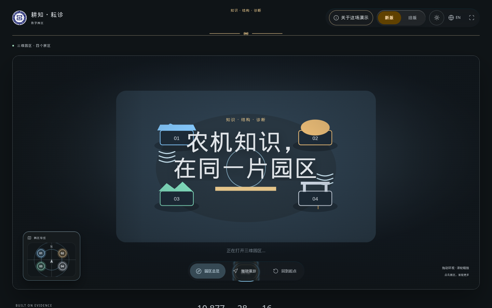

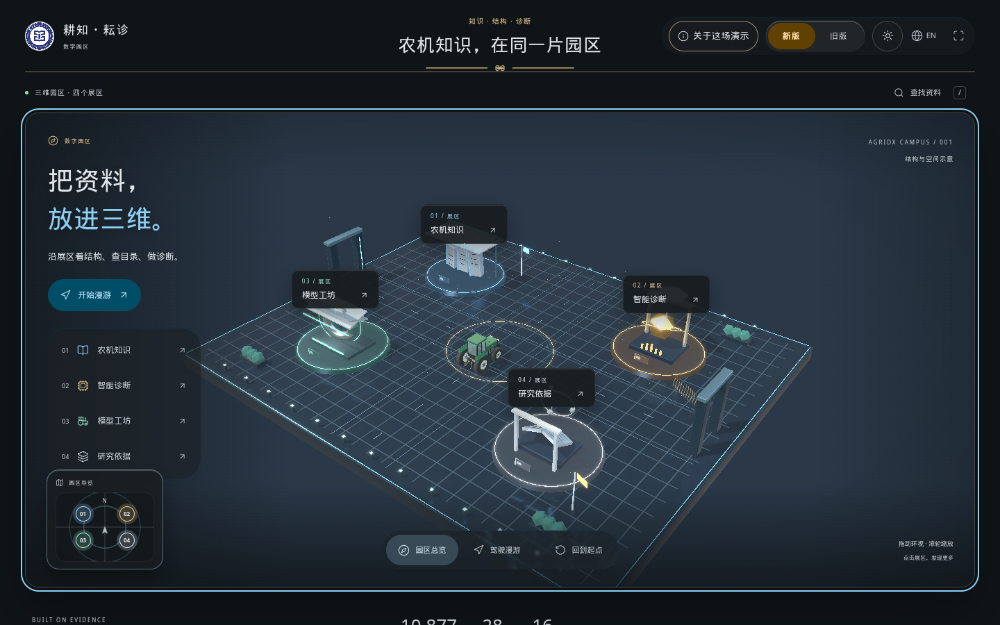

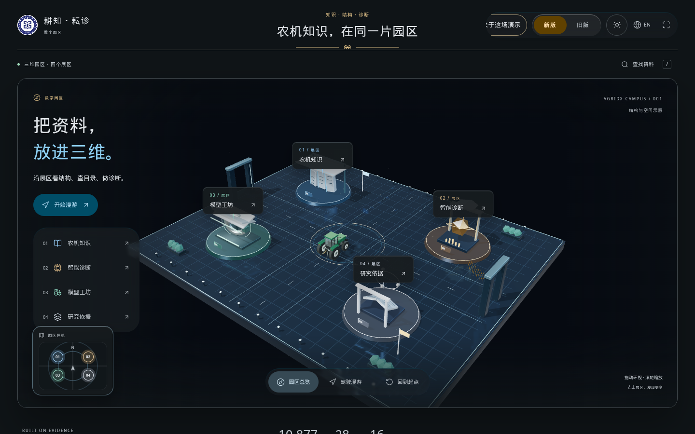

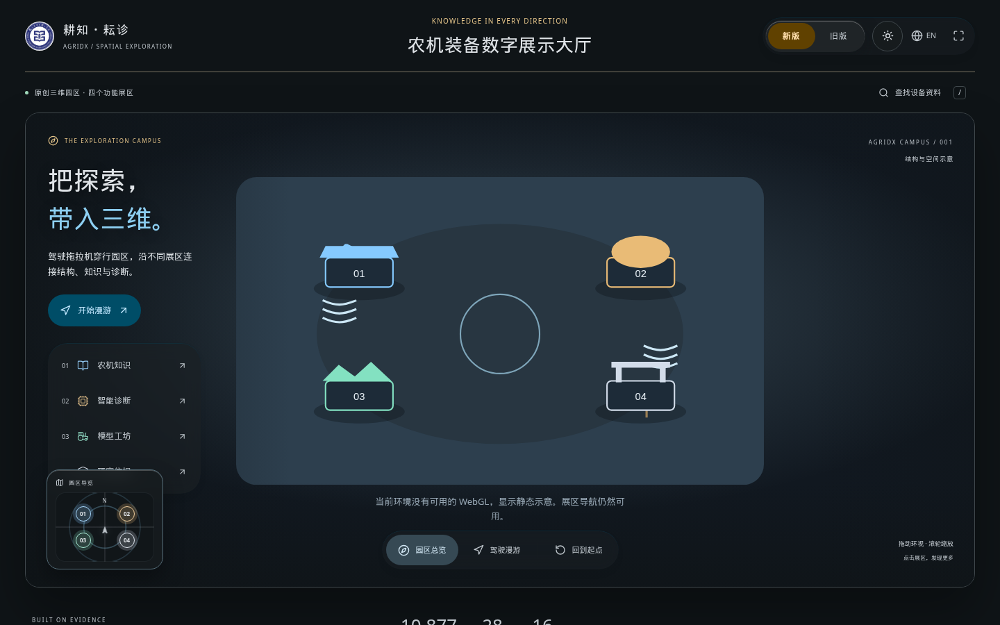

### 模型工坊 `/#/models`

新版工坊有棚拍条：日光、棚拍、夜间；实体、隔离、透视。展开结构示意时，七个部件沿引出线标出名称。测量条写明「结构示意」，比例按最长边记为 100，并注明不是毫米或铭牌尺寸。自转只在转动时持续绘制，暂停后回到按需渲染。可以保存一张结构示意 PNG。

旧版模型页和首页预览没有这套棚拍条。WebGL 不可用时没有画布，文案来自 `modelPreviewFallback`：「当前浏览器环境不支持 WebGL」。

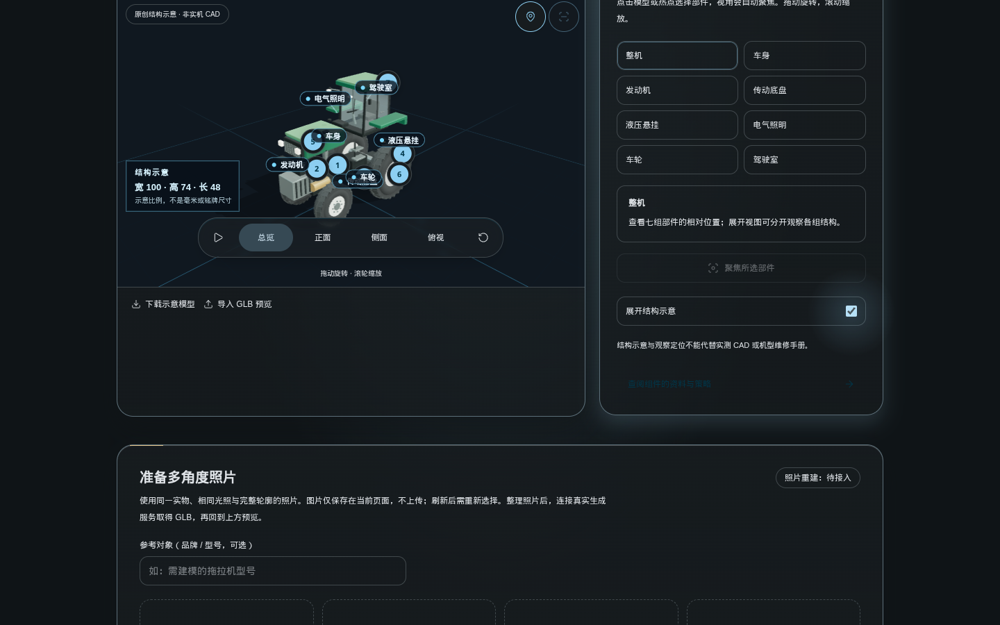

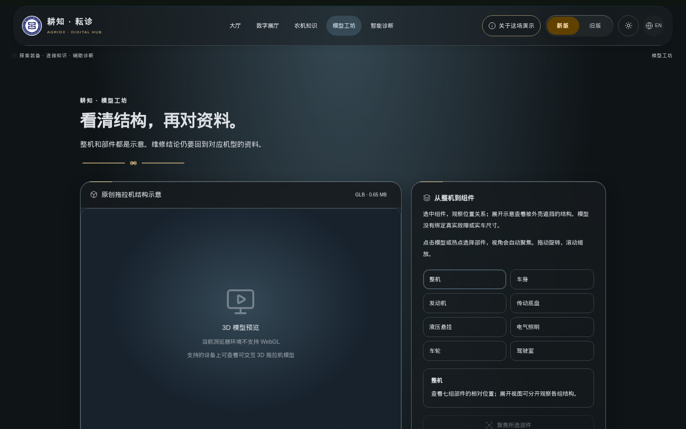

### 知识目录与诊断

知识目录沿用原来的筛选和计数。新版加上玻璃筛选条、品牌与型号角标卡片，以及细指针悬停时的无声线稿。窄屏和粗指针不显示线稿。

诊断工作台右侧是机具上下文。输入区聚焦时有青蓝光晕。旧版诊断不出现这套侧栏。

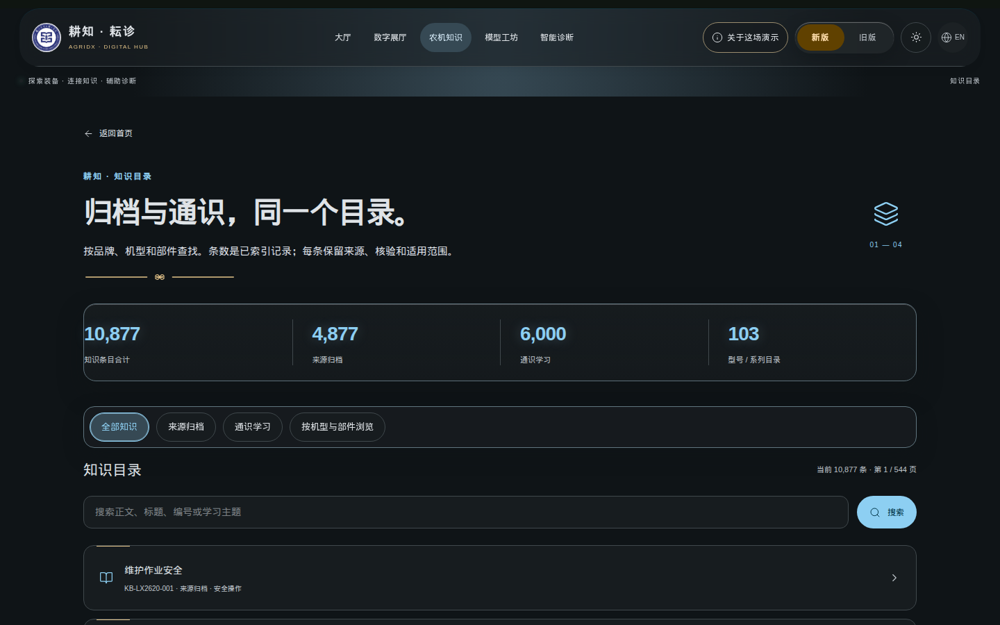

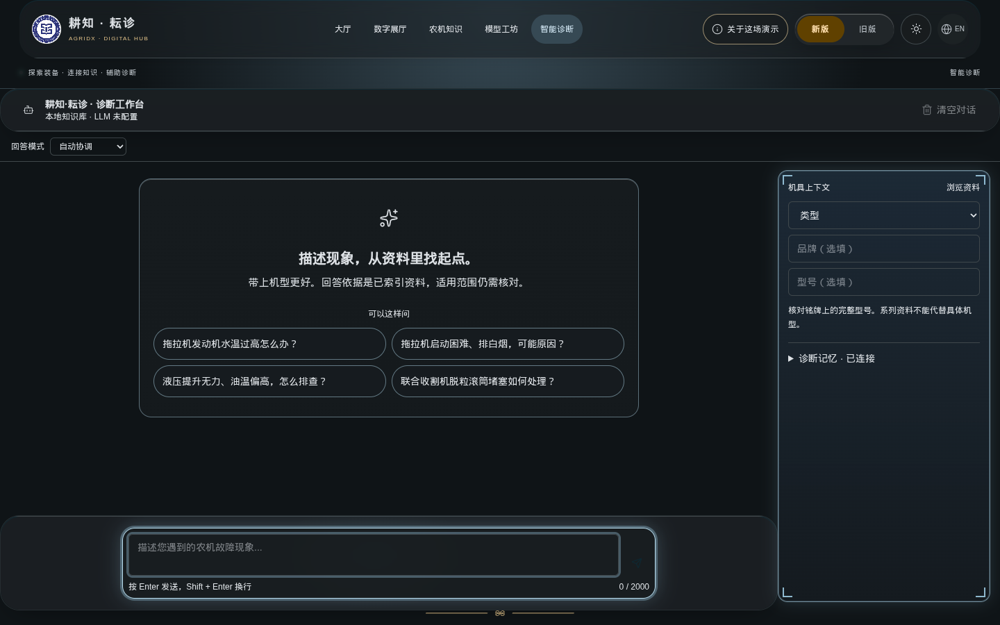

### 快速前往、过渡和 404

新版按 Ctrl 或 Command K 打开玻璃「快速前往」。条目在 `COMMAND_ROUTES`：大厅、数字展厅、农机知识、模型工坊、智能诊断。每条路径都有对应的状态条文案。输入「结构」只留下模型工坊。

卡片悬停轻轻抬起，并带一圈细的边框光。换展区时，大厅扫过一道光，只扫一次。运行环在打开时用约 1.6 秒画出。主按钮按下缩到 0.98，并亮一圈。光标高光只出现在展厅舞台里，离开就淡掉。这些都不循环。长页面顶部有一条跟滚动走的进度线。目录数字约 0.9 秒跳到终值，减少动态时直接显示。带 `title` 的控件在约 320 毫秒后出现同一套玻璃提示，带箭头。诊断提示用 sonner，颜色跟着当前主题。按 `?` 打开快捷键表。这些只挂在新版上。

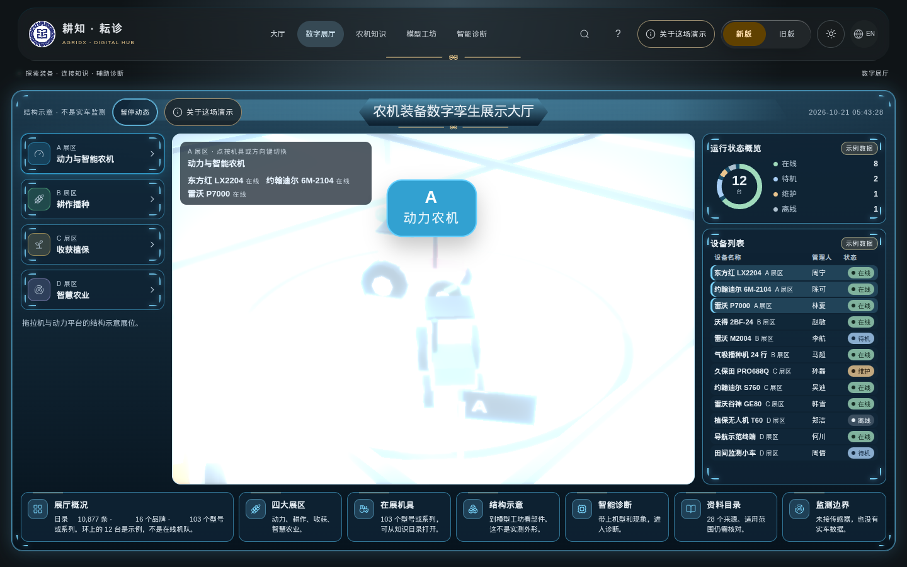

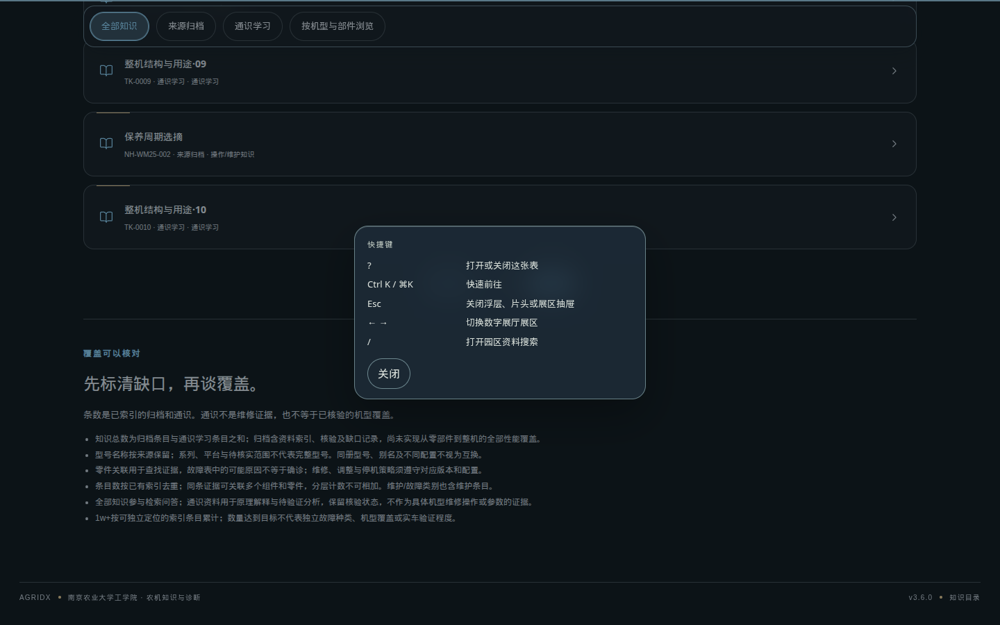

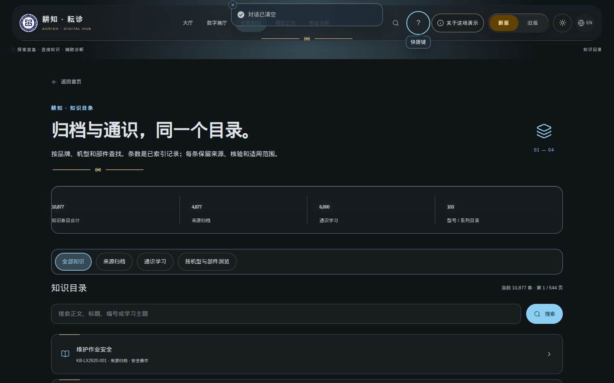

`beginSharedTransition` 在支持 `startViewTransition` 且未开启减少动态时，把来源元素过渡到目标页的 `[data-shared-target]`。其余情况直接导航。

新版未知地址使用外壳、麦穗线和五个去向。旧版未知地址保持原样。

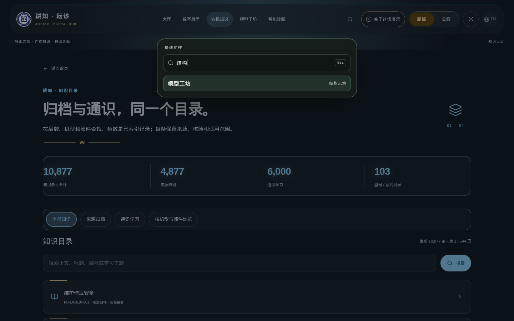

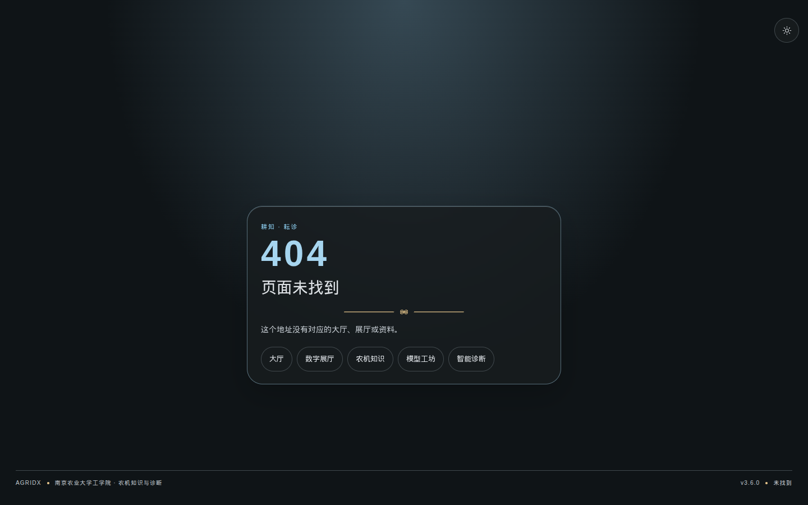

## 代码落在哪里

| 关心的事 | 文件 |
| --- | --- |
| 枢纽色、展厅夜色 | `src/tailwind-theme.css` |
| 角标、示例胶囊、共用焦点 | `src/new-version-tokens.css` |
| 麦穗线 | `src/wheat-motif.css` |
| 展厅示例数据、方向键、分区机具 | `src/pages/HallPage/hall-example-data.ts` |
| 园区路径 | `src/pages/ExhibitionPage/world-navigation.ts` 的 `pavilionDestination` |
| 过渡 | `src/lib/shared-transition.ts` |
| 快速前往、状态条、404 文案 | `src/lib/command-routes.ts` |
| 倾斜、进度、数字、提示、快捷键 | `src/lib/delight.ts` |
| WebGL 文案 | `src/lib/scene-fallback-copy.ts` |
| 棚拍灯光、引出线、测量比例 | `src/components/studio-schematic.ts` |

三维场景文件（`ExhibitionWorld.tsx`、`HallScene.tsx`）仍按一个场景放在一起。可单测的决定抽到上面这些纯函数里：展区折返、分区机具、示例标签、展亭去向、过渡名、命令筛选、WebGL 文案。
