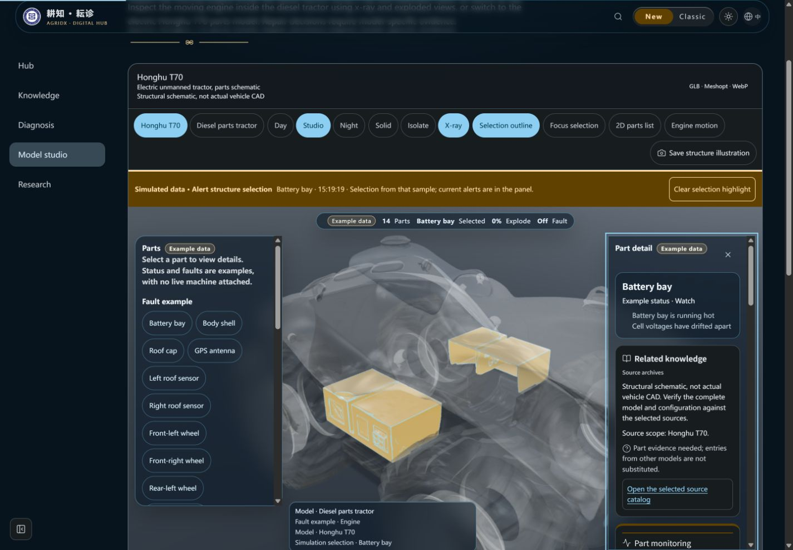
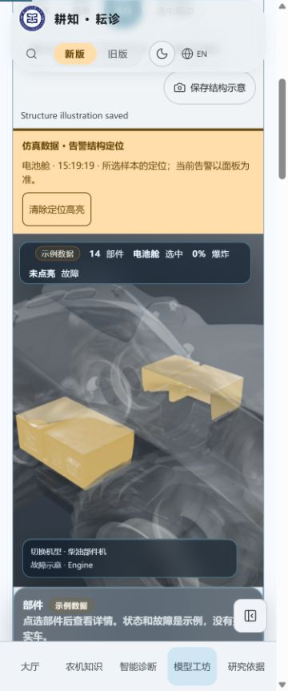
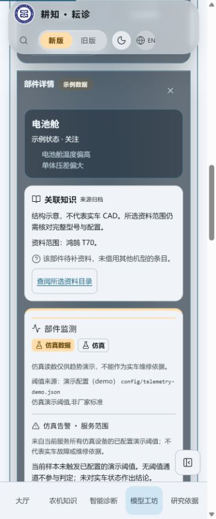
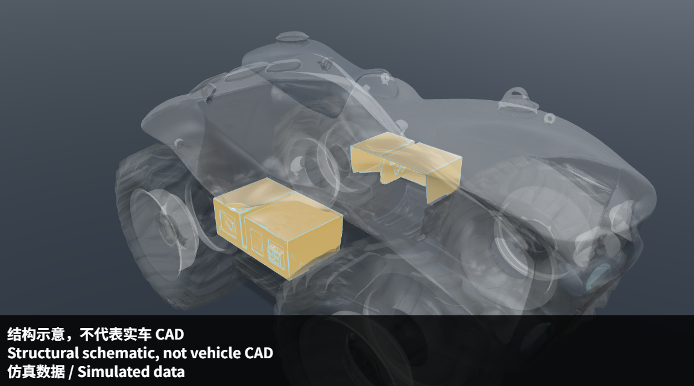

# 仿真告警结构联动验收（2026-10-25）

原告警列表只能读取。本批复用已有部件选择、聚焦和PartKnowledge，增加按遥测目录与实际parts.json共同校验的查看入口。来源、机型/部件和样本时间进入结构选择，读数/阈值不进入知识查询。静态仿真材质与旧示例故障pulse分离。

## 本地验证

- Node24.22.1；feature批次`ui-telemetry-alert-link-20261025`先dry-run再执行3.23.0 → 3.24.0，知识版本不变，无新增依赖。
- `node --import tsx --test tests/parts-simulation.test.ts tests/telemetry-alerts.test.ts tests/telemetry-presentation.test.ts tests/parts-interaction.test.ts`：27/27。新增6项覆盖两机型实际部件映射、未知/无阈值/非仿真/错误时间拒绝、材质与旧脉冲/描边隔离、导出水印、重置滚动/焦点/减少动态及可选入口。
- 最终`npm run verify`：652项、636通过、16项Linux专用测试在Windows跳过、0失败，版本/知识哈希/三组类型/Lint/完整前后端构建通过；日志在工作区外`pr6b3b-verify-final.log`，session91937 exit0。此前初验651通过后，真实UI发现抽屉保留滚动位置，增加焦点/滚动回归及明确按钮名，再全量验证和重验。保留既有Fast Refresh和大块构建警告。
- 普通生产构建`http://localhost:3144/#/models`，真实本地后端SSE/history与场景控制，seed **2777**，外部AI关闭。未使用前端造数或假阈值，未实车验收。
- 1440×1000英文深色：启动battery-spread循环，切柴油结构并点亮旧发动机示例故障；告警出现后按Enter查看T70电池压差。实际DOM变为model=t70、component=battery_box、simulation=battery_box、旧fault为空、X-ray开启，焦点在Part detail且scrollTop=0；T70资料显示待补与既有目录入口。新的金色材质静态显示，旧红色示例关闭。
- 标记保留选择时的15:19:19采样时间，并说明当前告警以面板为准；循环回落后没有把仍选中的结构写成当前告警。截图记录这一界限。
- 实际点击Save structure illustration，下载`agridx-honghu-t70-simulated.png`，711016字节；检查原始PNG：金色电池结构可见，底部三行中英结构/CAD限制及固定“仿真数据 / Simulated data”清晰。文件复制为本目录export-simulated.png，未后期补水印，绘图发生在导出副本。
- 375×900中文浅色：data-outline=off，仿真标记仍为battery_box，静态材质保留；页面宽360≤375，清除入口90×44px。切手动二维降级后选中部件与资料仍在；关闭详情后data-simulation为空、标记消失，焦点恢复到data-selection=battery_box按钮。键盘Enter重新打开成功。
- 二维详情实测“待补资料”，点击既有目录入口后加载`/#/knowledge?view=machine&brand=鸿鹄&model=T70`，五入口和型号筛选保留，没有遥测读数/阈值/故障结论参数。T70两条是范围/缺口资料，未当作电池维修证据或部件覆盖。
- 浏览器error日志为空。手动二维是等价降级验证，不冒充物理GPU故障；375为视口验证，不冒充物理触屏。减少动态下focus使用instant由确定性测试覆盖，没有改系统偏好。Scene仿真标记为可选默认null，旧FaultModel调用兼容，完整构建/既有测试通过。
- 最终重建前已停旧服务/标签，未再出现临时dist替换错误。最终服务43643、标签11均已关闭，viewport重置。

## 截图和实际导出

监测图片保留仿真标记。三维结构图来自真实UI下载，带固定仿真及结构限制水印。

| 1440英文深色：结构与资料 | 375中文浅色：无默认描边 |
| --- | --- |
|  |  |

| 二维详情及待补资料 | 实际下载PNG |
| --- | --- |
|  |  |

## GitHub及网页发布

用户最新要求恢复发布，覆盖旧“不部署/[skip ci]”约定。当前head全部PR检查通过后正常合并，现有Development preview更新公开开发网页；既有[dev-only]仅限制腾讯流程，CI和开发发布照常。实际运行、线上版本/源码SHA另记对应PR；本地验证不等于网页已发布。不改工作流、服务器、权限、密钥或archive。

当前公开开发站是静态预览（本批发布前HTTP健康为3.19.1），不运行后端SSE；它会如实显示监测服务不可用，不能拿本地仿真验收宣称后端已部署到静态站。Express服务中的仿真功能与网站构建发布分别记录。

旧FaultDetectionPage/demo前端生成器仍待迁移到同一后端流，第7/8步仍未完成。仿真不进入知识检索、覆盖/质量统计、诊断或长期记忆。本批是人工结构浏览，不增加Agent工具、循环或权限。
