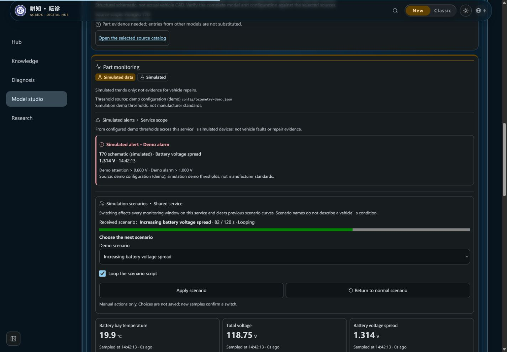
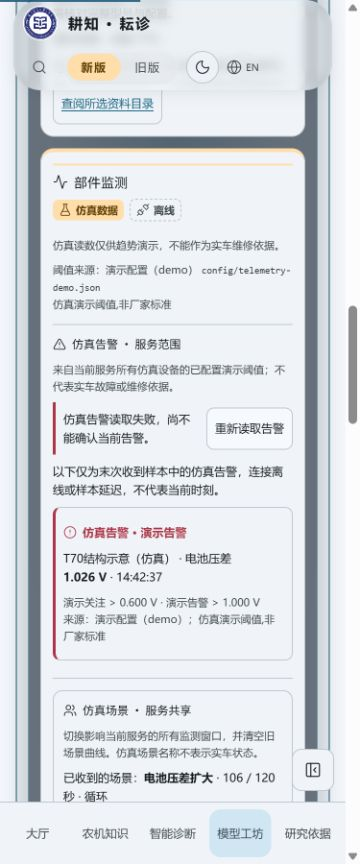
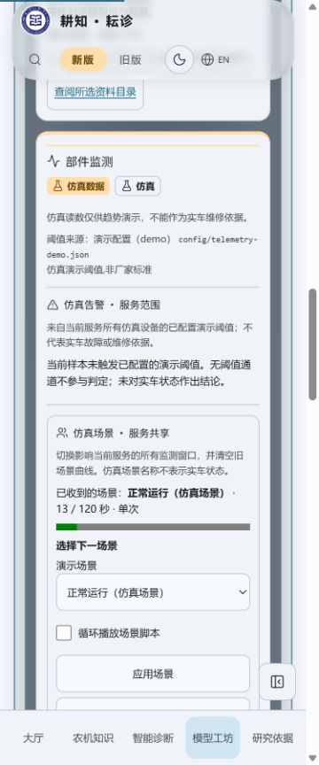

# 只读仿真告警列表验收（2026-10-25）

现有统一流已有配置告警，但部件监测面板未显示。本批在场景选择上方增加只读列表，不生成采样或计算阈值。显示服务范围和仿真限制，每项含设备/通道、演示关注或告警、原始读数/时间和目录阈值出处。

## 本地验证

- Node24.22.1；feature批次`ui-telemetry-alerts-20261025`先dry-run再执行3.22.0 → 3.23.0；无新依赖，无知识内容变化。
- `node --import tsx --test tests/telemetry-alerts.test.ts tests/telemetry-presentation.test.ts tests/telemetry-scenario-controls.test.ts`：21/21。新增6项覆盖真实后端帧的展示/出处/时间、加载/失败/空样本、不据空列表作结论、离线/延迟末次标注、无阈值或范围/来源不匹配时停止展示、图标文字与非打断读屏。加强两种等级断言后告警6/6再通过。
- 最终布局`npm run verify`：646项、630通过、16项Linux专用测试在Windows跳过、0失败，版本/知识哈希/三组类型/Lint/前后端构建通过。日志在工作区外`pr6b3a-verify-final.log`，session2030完成0。此前初次完整验证同样通过，随后仅调整新告警区到场景上方并重跑全量；保留既有Fast Refresh与大块构建警告。
- 普通生产构建`http://localhost:3144/#/models`，真实本地Express仿真器、SSE/history/场景POST，seed **2777**，外部AI关闭。没有前端造数、外部模型或实车验收。
- T70电池舱：实际场景控件选择电池压差扩大并循环，目录阈值触发演示关注后转演示告警。1440×1000英文深色截图记录脚本82秒的原始样本、相同时间与演示阈值。三维侧栏曾加载同一组件，截图使用等价二维宽面板便于查看来源；不新增或改变WebGL路径。
- 375×900中文浅色：停止后端，列表标明读取失败与“末次样本，不代表当前时刻”；缓存的仿真告警时间停留14:42:37。DOM宽360≤375，重读按钮90×44px，computed animation=none/transition=0s，aria-live=off。状态有文字与图标，未把离线空列表解释为无故障。
- 恢复后端后，原生SSE重连到新run，旧告警清除，显示未触发演示阈值以及“不对实车状态作结论”；对应正常仿真场景名称仍只指脚本。当前页面未向模型、检索或统计发送仿真数据。
- 真实验收窗口error日志为空。临时静态服务在最终构建替换dist过程中曾有一次旧文件ENOENT；完成构建后已重新载入再验收，未修改服务器配置或将其宣称为线上问题。后续重建前先停临时静态服务。
- 加载、延迟、配置不一致由确定性测试验证，截图不冒充捕获全部状态。没有修改系统减少动态设置；现有面板无动画规则覆盖该偏好。375为视口验证，不冒充物理触屏。

## 截图

三图均保留固定“仿真数据”徽章和演示色带，无实车结论。

| 1440英文深色：仿真告警与出处 | 375中文浅色：离线末次告警 |
| --- | --- |
|  |  |

临时服务41693/81216、标签9均已关闭，viewport已重置。

## GitHub和交付边界

GitHub保存、精确head Ubuntu/Windows/ci-verify及合并另记PR。未部署；合并提交[skip ci]并核对实际merge SHA无Actions。不改工作流、权限、密钥、实际环境、服务器配置或archive分支。

当前列表只读，点击定位/独立仿真高亮与知识入口下一批交付；旧工作台前端生成器迁移及第7/8步尚未完成。LLM/Memory/Planner及Agent工具不适用，仿真仍不进入检索、记忆或覆盖/质量统计。
