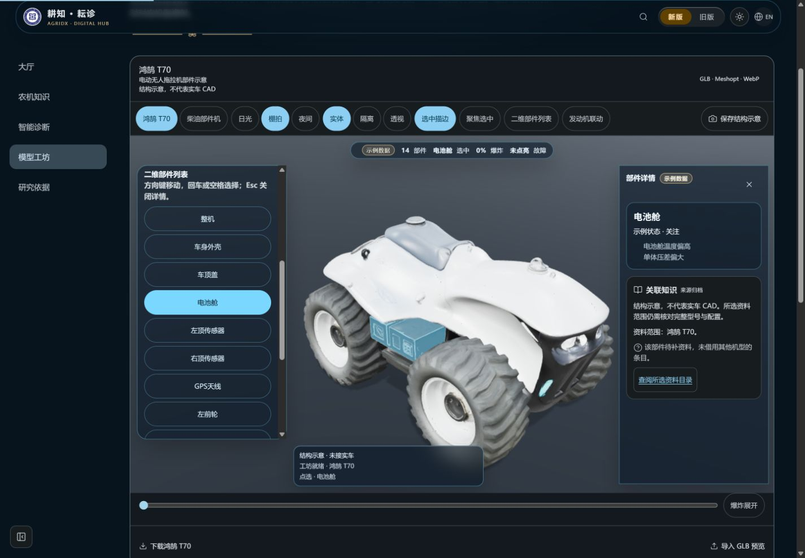
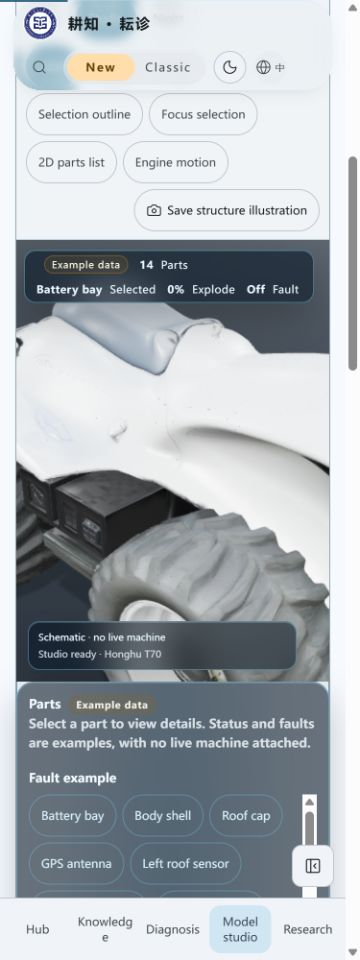

# 仿真基础批次回归

2026-10-25，3.18.2，分支codex/ui-telemetry-core-20261025。本批仅共享类型、JSON演示配置、后端纯生成器和测试/协议文档，无页面或接口挂载变化。这些截图仅用于确认既有界面，不能作为监测图表已接入的证明。

- Node24.22.1；`npm run verify`通过：580项、564通过、16项Linux专用测试在Windows跳过、0失败；版本、知识库哈希、类型、Lint、前后端构建通过，保留既有Fast Refresh及大chunk警告。
- `node --import tsx --test tests/telemetry-simulator.test.ts`：12/12。测试种子0、2777、4294967295及五场景，包含日周期、时间轴、循环、超长安全时钟、有限量程、无阈值空告警和来源隔离。默认种子2777。
- 正常生产构建在后台IAB测试1440×1000中文深色、375×1000英文浅色；T70选择电池舱和知识待补资料正常，手机默认描边关闭，部件控件最小44px，页面scrollWidth360≤375，控制台无error。未调用模型、上传照片或更改系统设置。
- 本批没有监测区、数据文件或图片导出入口；共享帧/目录强制水印，采样保留source。未来前端接入仍须固定仿真徽章/色带与导出水印验收。
- 服务与临时标签已关闭。GitHub精确head的检查、合并SHA与未部署核对另记PR；本地通过不表示线上发布。

| 桌面1440px | 手机375px |
| --- | --- |
|  |  |
