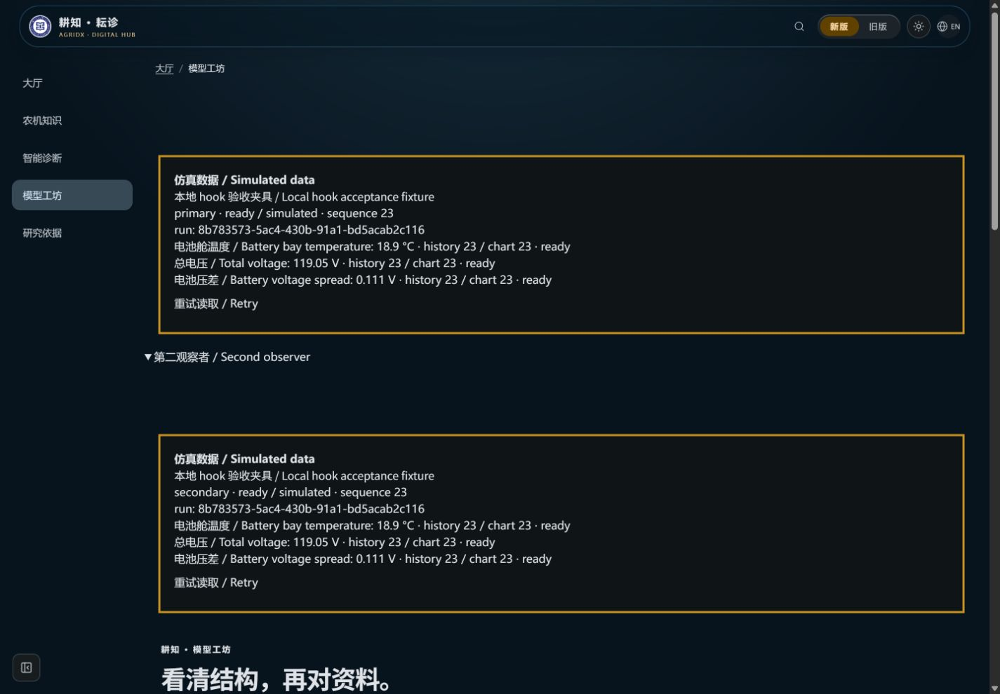
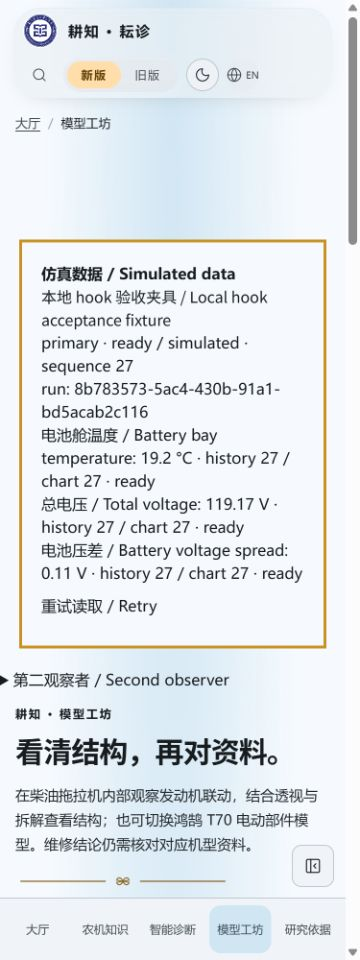
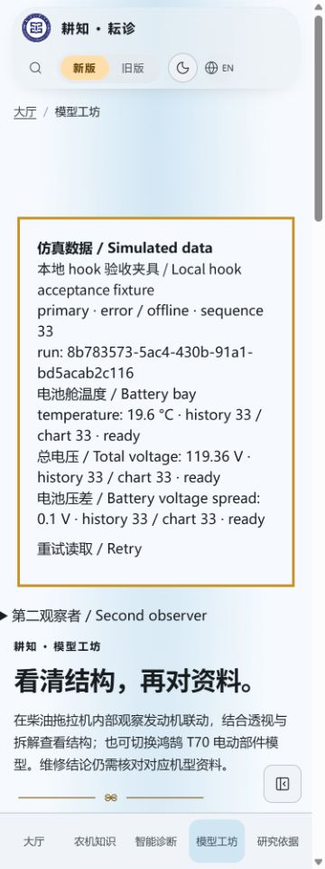
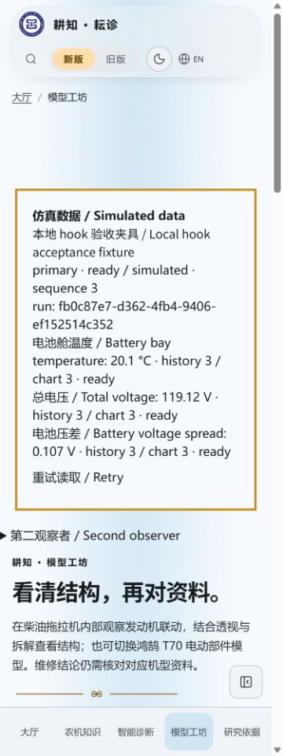

# useTelemetry 数据层验收

2026-10-25，3.19.2。内部数据层准备，生产页面尚未挂载监测区；下列图片来自明确标记的本地读取夹具，不是最终监测UI。main并行合入Agent指南3.19.1后，本批按脚本从该版本顺延，保留对方全部文档和批次记录。

- Node24.22.1；客户端定向12/12通过。覆盖协议来源/水印/范围/无阈值告警拒绝、部件与设备隔离、共享连接/Strict Mode、原生重连、心跳不刷新采样年龄、历史去重/新点合并、卸载再挂载补读缺口、旧run响应丢弃、失败/空数据/重试、静态无后端、3600点上限及240点峰值降采样。
- 最终完整 `npm run verify`：610项、594通过、16项Linux专用测试在Windows跳过、0失败，版本/知识库哈希/类型/Lint/完整构建通过；保留既有Fast Refresh和大chunk警告。
- 仅新增protocol/store、薄hook及测试/文档，无依赖变更；未修改生产页面、主题、导航或URL。普通构建不加载此模块或开启SSE，后续组件按需引用。

## 真实React与原生SSE

运行 `node --import tsx tests/browser/telemetry-hook-fixture.mjs`，构建前只在ModelPage插入两个读取观察者，元信息`agridx-qa-mode=telemetry-hook`。生产源文件和正常dist不修改，夹具输出独立工作目录，仅监听127.0.0.1:3143，禁用外部模型，后端种子2777；不在前端造点，不替换EventSource或时钟。

1440×1000中文深色中，两观察者都ready/simulated、同一run，三路电池舱数值及历史持续更新；375×1000浅色无溢出（scrollWidth360≤375），仿真标注固定在读数之前。正常与恢复后控制台无error。

协调为3.19.2后刷新全部四张截图。停止自己的本地服务后，两者转为error/offline，原读数仍有明确离线与仿真标记。恢复本地服务后，原生重连收到新run；旧run从33点清为新run3点并恢复ready/simulated，证明重启未混用缓存。旧/新run分别为`8b783573-5ac4-430b-91a1-bd5acab2c116`、`fb0c87e7-d362-4fb4-9406-ef152514c352`；均为仿真会话标识。单连接与挂载缺口的精确计数由可控传输单元测试核对，未从浏览器隐藏状态取证。

| 桌面两个观察者 | 手机正常读取 |
| --- | --- |
|  |  |

| 本地服务断开 | 自动重连新run |
| --- | --- |
|  |  |

空数据、延迟边界、非法设备来源和静态预览不可用由单元测试覆盖；没有为了截图制造未标记的设备数据。所有图片包含“仿真数据 / Simulated data”。服务、浏览器标签和临时viewport均已清理。

## 后续边界

指标卡/StatTicker精度、时序图与悬停/键盘/文字替代、固定生产徽章与色带、导出标记、减少动态及旧FaultDetectionPage仿真迁移仍需下一批实现。当前hook提供数据/状态/重试，不对无阈值通道下正常或异常结论，也不发送监测摘要给模型。真实device保留类型但当前读取器拒绝它，未来接入需单独审核。

GitHub精确head CI、合并及未部署结果另记PR，不将本地验收写成线上发布。
