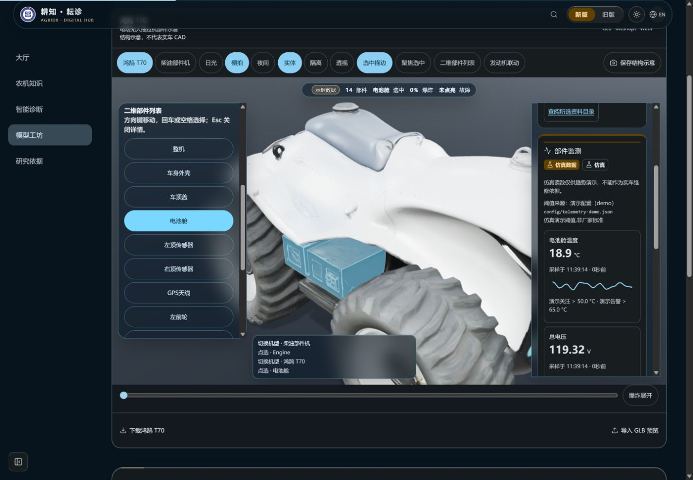
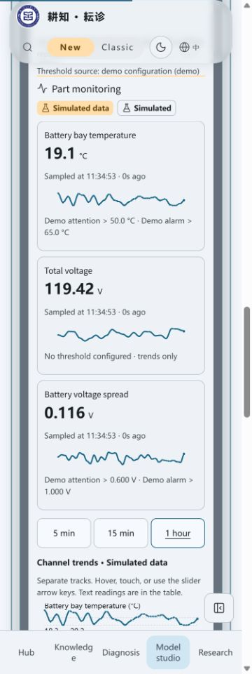
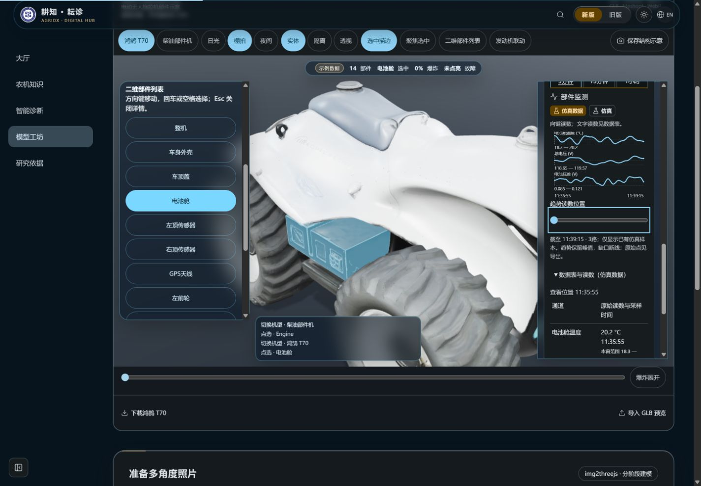
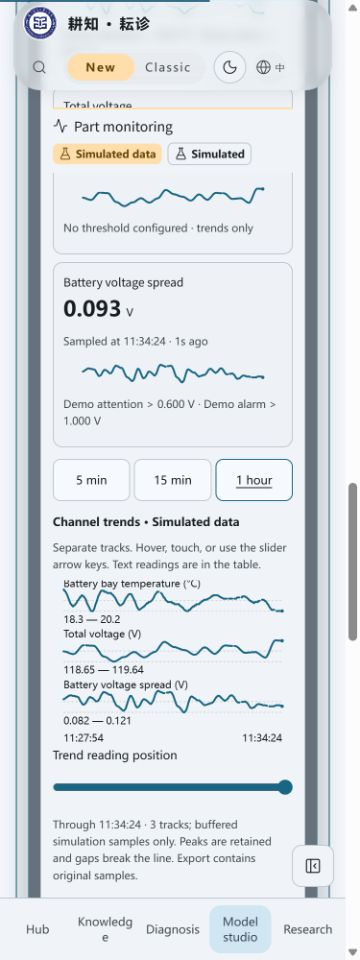
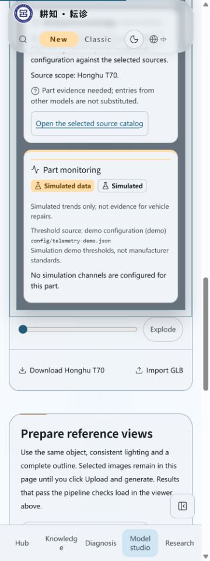
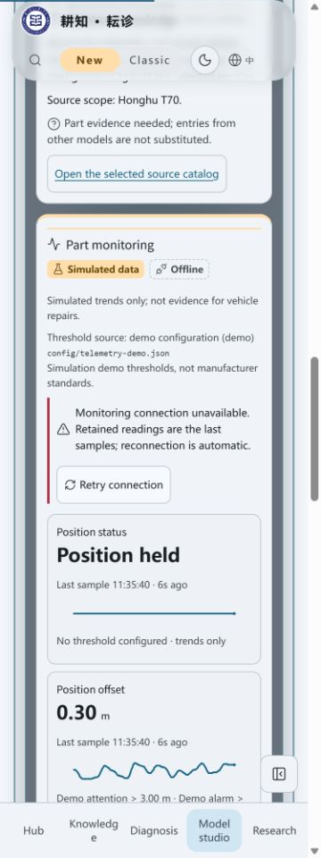
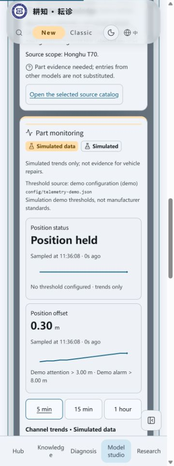
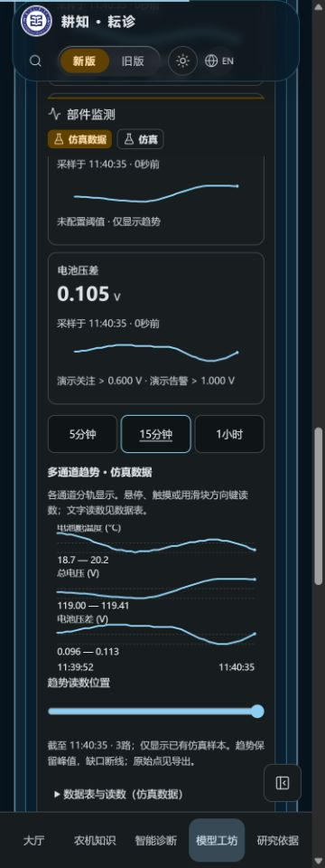
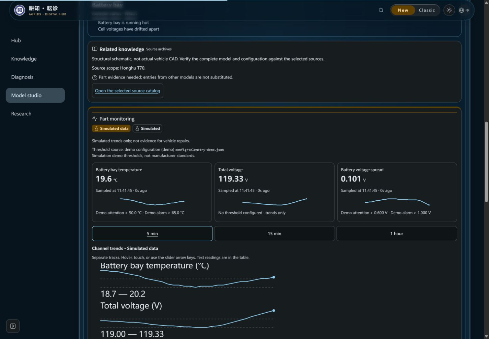

# 部件仿真指标与趋势验收

2026-10-25，3.20.0。仅在现有PartsStudio抽屉增量加入部件监测，保留示例故障、关联知识、三维与二维入口。全部监测读数来自后端仿真，种子 **2777**；不是实车试验或厂家参数验证。

## 自动验证

- Node24.22.1。`node --import tsx --test tests/telemetry-client.test.ts tests/telemetry-presentation.test.ts`：20/20通过。
- 最终`npm run verify`：618项，602通过、16项Linux专用测试在Windows跳过、0失败；版本、知识哈希、前后端类型、Lint与完整构建通过，保留既有Fast Refresh/大chunk警告。
- 新逻辑覆盖：先按时间窗筛选再保留原始峰值、最近原始点读数、缺口断线/状态阶梯、单点与空数据、精度/直接值、三态与固定仿真标记、历史失败/重试、离线/延迟文字、表格和CSV来源/文本公式防护。原有连接、取消、重连、旧run拒绝与上限测试再次通过。
- 无新依赖。监测及数据层分包24.62 kB / gzip9.38 kB，选中部件后才加载；不把SSE或图表放入首屏阻塞链路。StatTicker默认整数行为保留，监测使用配置精度并直接显示样本，不计数插值。

## 正常生产构建

本机正常构建运行于127.0.0.1:3144，禁外部AI、后端仿真种子2777。使用真实React、原生EventSource与history，未替换浏览器传输、时钟或前端采样。

- 1440×1000中文深色：T70电池舱显示温度/总电压/压差；柴油发动机显示转速/冷却液温度/机油压力，切换后不借用另一模型通道。柴油知识入口仍要求手动选资料范围；T70仍标待补资料。
- 375×1000英文浅色：页面scrollWidth360≤375；新增按钮、滑块和表格展开至少44px。手机原导航高94px，监测吸顶徽章与色带位于112px，滚到图表时可见。所有新图形computed animation为none、transition为0s。
- 5m/15m/1h可切换；Home键将滑块与表格定位到实际缓冲首点（正常服务重启前11:27:54、重启后11:35:55），表格同时显示实际采样时间和范围。原始点与观察位置不混为新读数。
- GPS显示“Position held”等状态文字，无阈值通道明确“No threshold configured · trends only”；车身外壳显示未配置通道空状态，不生成读数。
- 停止自己的本地服务后显示Offline/Last sample及重试，仿真标记保留；恢复后原生自动重连。可见SVG路径长度从1781/2515缩为204/191，时间轴重新开始，旧run曲线清理；精确run/缓存断言见单元测试。
- 实际CSV导出：正常生产15m文件288行；最终构建5m文件240行，全部watermark为“仿真数据 / Simulated data”、source为simulated、device_id为t70-demo，带通道/部件及配置阈值来源/说明。测试另核对文本公式和前置空白防护。
- 旧界面仍使用原来的七组件模型，Engine选择和来源入口通过回归；没有将本批PartsStudio监测伪称为旧模型已有能力。旧/新切换、主题和语言均保留，控制台无error。

## 受控降级分支

复用`node --import tsx tests/browser/parts-studio-fixture.mjs unsupported|reduced`。仅在构建前控制已有WebGL探测或减少动态分支，生产源文件不改；接口和采样仍为真实本地后端仿真。

- unsupported，3138/375px：DOM无canvas，等价二维列表选中电池舱，知识入口及三路监测可操作，固定徽章可见，scrollWidth360≤375。
- reduced，3139/1440px：PartsStudio带is-reduced，所有监测子元素animation=none、transition=0s；二维宽面板三列指标，图形与表格继续可用，控制台无error。
- 这些是受控构建与响应式检查，不是物理关闭GPU、操作系统偏好覆盖或真实触屏硬件试验。加载/读取失败/无数据与延迟边界另有确定性组件/数据层测试，不为截图编造未标记采样。

## 截图

| 桌面三维与指标 | 375px指标 |
| --- | --- |
|  |  |

| 桌面趋势与文字替代 | 手机图表与固定标记 |
| --- | --- |
|  |  |

| 未配置通道 | 离线 | 自动重连 |
| --- | --- | --- |
|  |  |  |

| 无WebGL | 减少动态的二维宽面板 |
| --- | --- |
|  |  |

旧界面回归另见`desktop-classic-regression.jpg`；未显示监测读数，无仿真水印要求。其余监测图片全部包含固定仿真标记。临时标签、viewport及3138/3139/3144服务已清理。

## 交付边界

本地验证与截图已完成；GitHub保存、精确head的Ubuntu/Windows/汇总CI及合并另记PR。未部署，不改工作流/权限/密钥/服务器配置或archive分支。

旧FaultDetectionPage前端生成器尚待场景阶段迁移至同一后端流；场景切换、仿真告警联动、聊天证据/可选摘要及图谱增强仍待后续小PR。本批不向模型发送监测数据，不把仿真写入检索、记忆、覆盖或质量统计。
