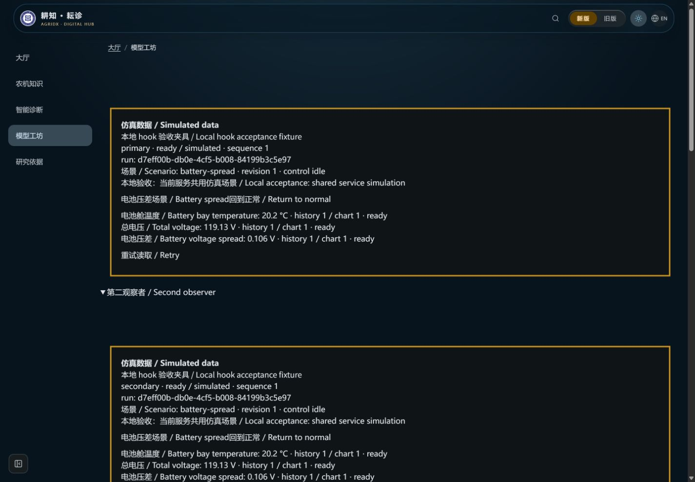
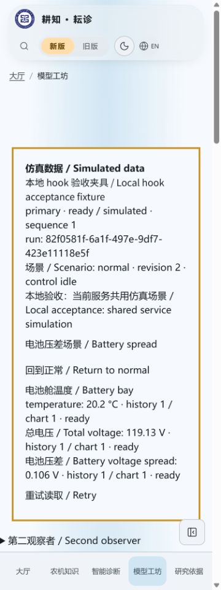

# 客户端场景方法验收

2026-10-25，3.21.1；兼容数据层维护。尚未在生产页面加入场景选择器、仿真告警/三维联动或旧工作台迁移。

- Node24.22.1。客户端/展示/场景客户端定向28/28通过；新增8项覆盖可选元数据、串行请求、HTTP回执不替代采样、新run先于回执、409不重试/不覆盖、错误来源/回执、离线/延迟/旧元数据拒绝写入、限流/网络失败、12秒超时及取消/迟到回执丢弃。
- 最终`npm run verify`633项、617通过、16项Linux专用测试在Windows跳过、0失败，版本/知识哈希/前后端类型/Lint/完整构建通过，保留既有警告。无新依赖，未改生产界面/导航/主题/语言或SSE读取路径。
- 实际`node --import tsx tests/browser/telemetry-hook-fixture.mjs scenario`，仅本地构建夹具增加两按钮，生产源文件和正常dist不变。元信息agridx-qa-mode=telemetry-hook；127.0.0.1:3143，外部AI关闭，真实后端仿真种子2777，未替换EventSource、时钟或生成前端采样。
- 1440中文深色：从normal/revision0切battery-spread，两个观察者收到同run `d7eff00b-db0e-4cf5-b008-84199b3c5e97`、revision1、control idle、sequence1；旧54点历史清为1点。
- 375浅色：手动回normal，两观察者换新run `82f0581f-6a1f-497e-9df7-423e11118e5f`、revision2、sequence1，固定双语仿真标记与共享服务说明保留；scrollWidth360≤375，按钮至少44px，控制台无error。
- 409、超时和取消由确定性传输测试验证；夹具正常网络回执很快，截图不冒充捕获了全部中间状态。所有运行标识只是仿真会话，不是设备身份。临时服务、标签与viewport已清理。

| 两个真实hook观察者 | 手机回normal |
| --- | --- |
|  |  |

以上是明确标记的本地数据层夹具，**不是最终生产选择器**。本地验证、GitHub保存、精确head CI与合并分别记录；未部署，不改密钥、实际环境、服务器配置、工作流、权限或archive分支。正式选择器必须显示共用服务范围，409后核对当前场景再由用户手动选择，不能自动重写。
