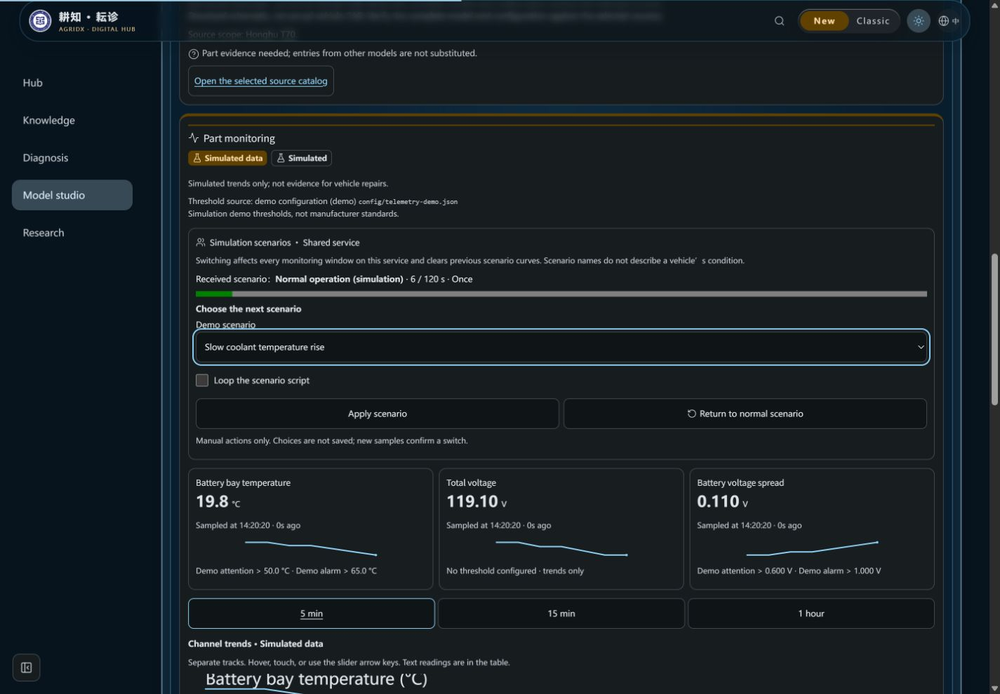
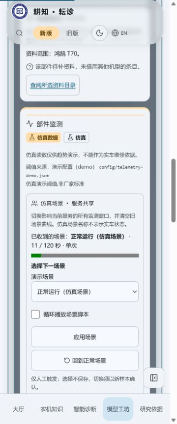
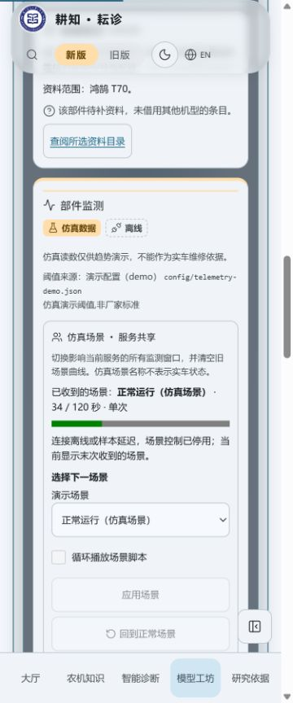

# 共享仿真场景控件验收（2026-10-25）

问题：后端场景API与前端统一控制方法已合入，生产部件面板仍无法人工选择场景。本批只增加正式控件，复用useTelemetry的元数据、串行控制、取消与并发保护，不在组件生成数据或直接访问API。

## 本地验证

- Node24.22.1，版本脚本feature先dry-run再执行，3.21.1 → 3.22.0，batch `ui-telemetry-scenario-controls-20261025`；无新依赖。
- `node --import tsx --test tests/telemetry-scenario-controls.test.ts tests/telemetry-presentation.test.ts tests/telemetry-scenario-client.test.ts`：23/23，新组件7项，覆盖元数据缺失、目录选项、进度、待处理/离线/延迟禁写、冲突追流、未确认错误及键盘/触控样式。
- `npm run verify`：640项、624通过、16项Linux专用测试在Windows跳过、0失败；版本/知识哈希/三组类型/Lint/前后端构建通过。保留既有Fast Refresh及大块构建警告。本地日志在工作区外`pr6b2-verify.log`，不提交私人日志。
- 普通生产构建页面`http://localhost:3144/#/models`，真实本地Express仿真器、原生SSE/history与场景POST，seed **2777**；外部AI关闭，临时数据库在仓库外。没有使用前端造数夹具，没有外部模型或实车验收。
- 1440×1000、英文深色：T70电池舱，先在三维侧栏选“电池压差扩大”并循环，收到新场景elapsed=0，旧曲线被清除；二维同等详情中键盘回到正常场景，收到单次基线。Home/ArrowDown只修改选择草稿，已收到场景仍为正常；Enter提交后才收到冷却液爬升场景。
- 375×900、中文浅色：回到正常场景后勾选关闭、新run/revision=4。实际API复核run `04305f90-c17a-4468-9b35-1922f872ddb2`，同run历史35点、source=simulated与水印保留。DOM宽360≤375，选择框/勾选标签/两按钮均44px；监测控件computed animation=none、transition=0s。没有改变系统的减少动态设置；监测无动画规则覆盖该偏好。
- 停止本地后端后显示“仿真数据 / 离线”，场景进度停留最后样本34秒，选择、循环与提交禁用。恢复后原生SSE自动重连，新服务run重新读取场景，状态与控件恢复；无前端补算进度或虚构未来读数。浏览器error日志为空。
- 409、超时/限流/坏响应、延迟以及元数据不完整用确定性客户端及组件测试验收，截图不冒充捕获了全部短暂中间状态。原生键盘交互已实际操作；375是视口测试，不当作物理触屏或新GPU验收。

## 截图

监测图片全部保留固定仿真徽章与色带。桌面图为等价二维详情，三维侧栏的同一控件也已实际切换；不改变现有模型和WebGL降级路径。

| 英文深色：键盘草稿与采样场景分开 | 375中文浅色：共享范围与选择 |
| --- | --- |
|  |  |

| 后端断线：禁用写入 | 原生SSE恢复 |
| --- | --- |
|  |  |

临时服务/浏览器标签均已关闭，viewport已重置。

## GitHub与部署

GitHub保存、精确head的Ubuntu/Windows/汇总CI和合并结果另记PR。本地通过不代替CI或部署。本批不部署，合并前要求全部必需检查通过，合并提交[skip ci]并核对其Actions无运行。不改工作流、密钥、实际环境、服务器配置、权限或archive分支。

仿真告警列表/三维与知识联动、旧FaultDetectionPage前端生成器迁移、诊断证据与可选摘要、图谱和检索卡等仍待后续。仿真不进入检索、覆盖/质量统计或长期事实记忆，不向模型发送数据。
