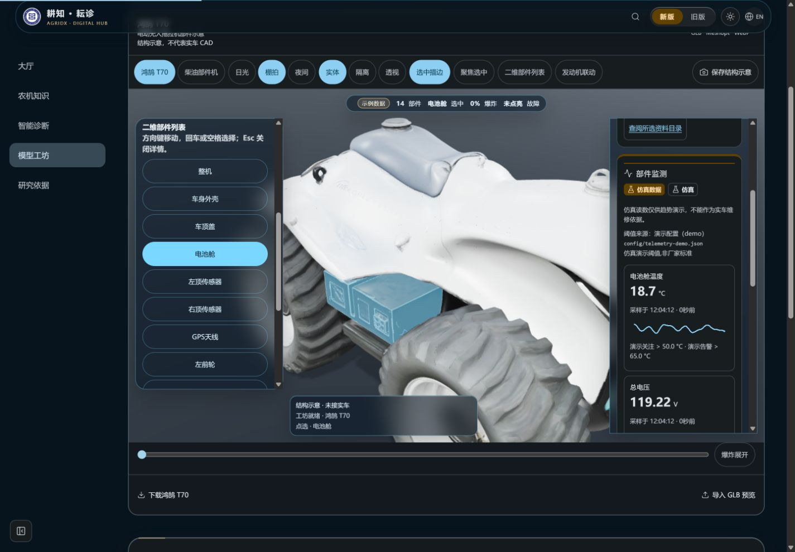
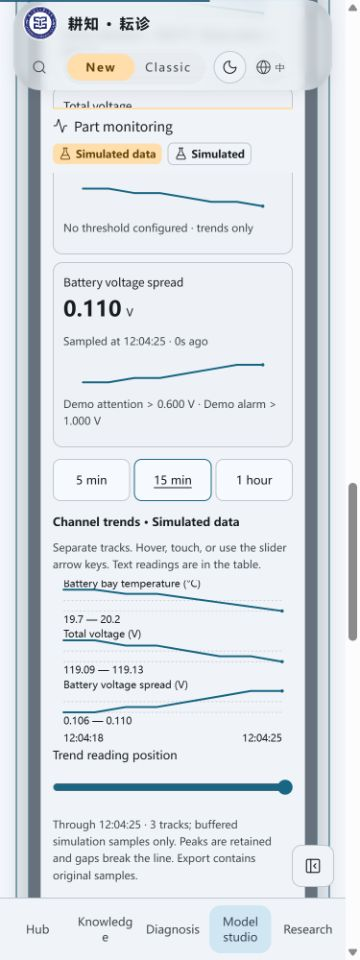

# 仿真场景控制API验收

2026-10-25，3.21.0，种子 **2777**。本批新增后端控制和兼容元数据，未加入场景选择界面、仿真告警联动或旧工作台迁移；不能把接口验收写成全部场景功能完成。

## 验证

- Node24.22.1；遥测simulator/runtime/API/client/presentation五组定向57/57通过。
- 最终`npm run verify`625项、609通过、16项Linux专用测试在Windows跳过、0失败；版本、知识哈希、前后端类型、Lint及完整构建通过，保留既有警告。
- 新测试覆盖五场景/循环/结束归基线、同种子回到normal、两订阅同一新run、旧历史/游标隔离、重复与过期runId/revision不覆盖、非法命令/回退时钟/坏替代ID不部分修改、同站/媒体/体积/查询/限流/关闭/脱敏，以及现有客户端对可选元数据的兼容。

## 正常服务烟测

本地正常服务127.0.0.1:3144，后端仿真种子2777，外部AI关闭。未改生产源/时钟/传输，未模拟设备数据。

- 两个原生SSE读取器收到同一个新run的sequence1与相同控制元数据，21通道。
- history只含新run现有的一点，旧游标得到新生成会话reset；回到normal再开不同run，revision递增。
- 过期命令409、1KiB以上JSON413、跨站Origin403、ingest404；实际结果带仿真水印/source，见[api-smoke.json](api-smoke.json)。
- 控制范围为当前服务共享场景，写命令不建立诊断身份cookie、不调用记忆、知识、统计或模型；这个范围是接口约定，前端接入时须明示。

## 现有界面回归

正常3.21.0生产构建，1440×1000中文深色选T70电池舱；375×1000英文浅色二维入口、固定仿真徽章、三路趋势/表格继续可用。scrollWidth360≤375，新增控件仍至少44px，控制台无error。

浏览器保持订阅时，通过本地API手动选择battery-spread：每路可见SVG路径长度由2899缩为109，时间轴从12:04:18重新开始，证明现有客户端收到新run后清除旧曲线而非混接。图片只显示已收到的仿真点，未等待到告警时间点；预定偏离、峰值和循环由可控时钟测试验证。最后API回到normal，临时服务、标签及viewport均已关闭。

| 现有桌面三维与指标 | 手机接收新仿真会话 |
| --- | --- |
|  |  |

截图为现有部件监测界面，固定仿真标记可见；不是尚未实现的场景选择UI，也不是实机/实触屏/厂家参数验证。

## 交付边界

本地验证、GitHub保存、当前head的两平台/汇总CI和合并分别记录。未部署，不改工作流、实际环境文件、服务器配置、密钥、权限或archive分支。后续前端控件应按409结果重新展示当前状态，等待用户再次选择，不能自动覆盖他人的场景。
