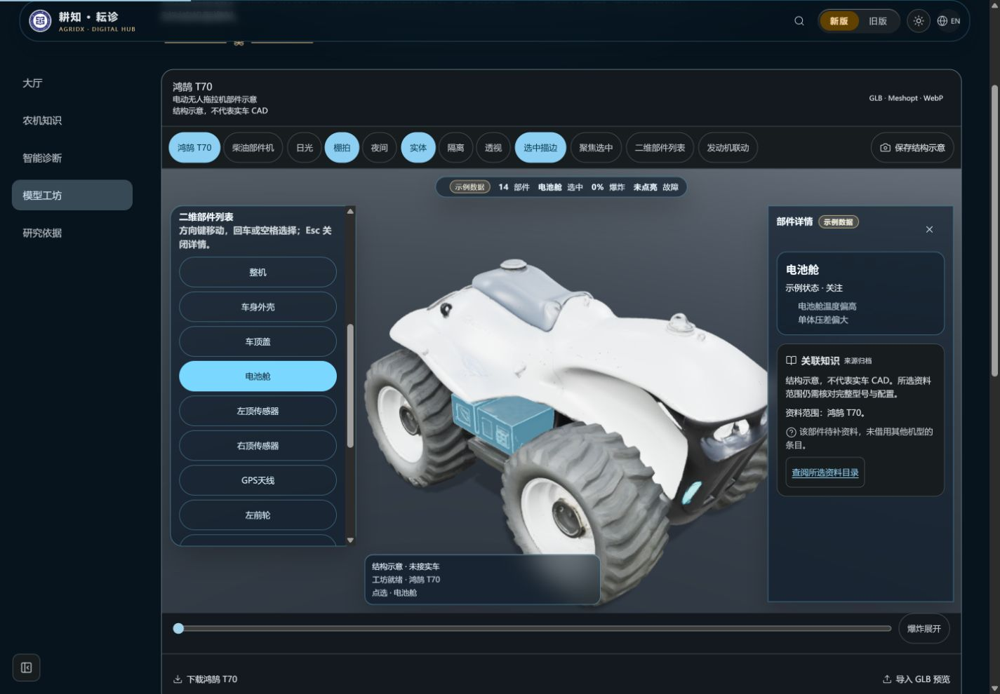
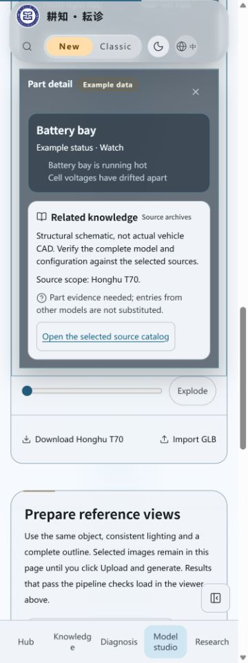

# SSE/history 接口稳定性与界面回归

2026-10-25，3.19.0，分支codex/ui-telemetry-stream-20261025。本批挂载后端读取接口，不改页面；回归截图不表示前端监测已接入。

## 本地验证

- Node24.22.1，`npm run verify`最终通过：598项、582通过、16项Linux专用测试在Windows跳过、0失败，版本、知识库哈希、前后端类型、Lint和完整构建通过。保留既有Fast Refresh及大chunk警告。
- `node --import tsx --test tests/telemetry-runtime.test.ts tests/telemetry-api.test.ts tests/telemetry-simulator.test.ts`：30/30。包括环形缓冲3600上限/长暂停补帧、窗口与游标严格校验、断开重放与三种重置、真实定时采样/心跳、新鲜度、源隔离、限流/连接释放、背压销毁和脱敏。早期断开测试因Express临时移除/api挂载前缀，观察器未附上，已修复并重跑；Lint const问题修复后全量通过。
- 审阅补充HEAD405，避免自动派发到持久GET；首次读取前时钟回退允许空数据，不输出undefined帧或倒序点。两项均有HTTP/运行时测试。
- 新增实现仅运行时、SSE写入器、遥测路由及既有app/runtime少量装配；无新增依赖、数据库、ingest、知识/诊断调用或首屏图表。

## 正常服务烟测

正常生产模式启动本地服务（禁外部AI，TELEMETRY_MODE=simulated、TELEMETRY_SEED=2777），使用真实HTTP流，不替换生成器或时钟。最终代码连续观察到21路通道、15帧采样和15秒心跳，所有帧/心跳/目录带simulated及固定仿真水印，采样有限且在配置量程内。history与流同一run、同一采样；断线后Last-Event-ID续读成功，旧服务游标收到server_restart重置，非法窗口400，ingest404。结果摘要保存为[api-smoke-result.json](api-smoke-result.json)，不包含设备私有数据或凭据。

测试HTTP应用使用抛错的诊断、知识目录、统计与模型状态注入，遥测读取仍成功，证明这条数据路径没有调用它们。关闭模式和非预期异常分别返回明确503及既有脱敏500。背压字节/事件上限用可控sink测试，未声称在真实网络中灌满生产缓冲。

## 页面回归

后台IAB检查正常生产构建1440×1000中文深色、375×1000英文浅色。T70电池舱选择、二维开关和知识待补资料/目录入口保留，结构示意与示例徽章保留；375px默认描边关闭，二维无canvas，按钮最小44px，页面scrollWidth360≤375，控制台无error。无照片上传或外部模型调用。服务与临时标签已关闭。

| 桌面1440px | 手机375px二维 |
| --- | --- |
|  |  |

前端useTelemetry/指标图表、现有FaultDetectionPage生成器迁移、场景控制/告警联动仍属后续小PR，不能把后端接口验收记为这些功能完成。未部署；GitHub精确head的Ubuntu/Windows/ci-verify及合并SHA核对另记PR。
