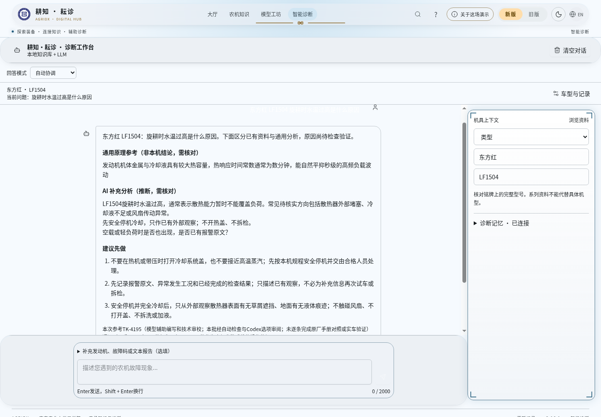
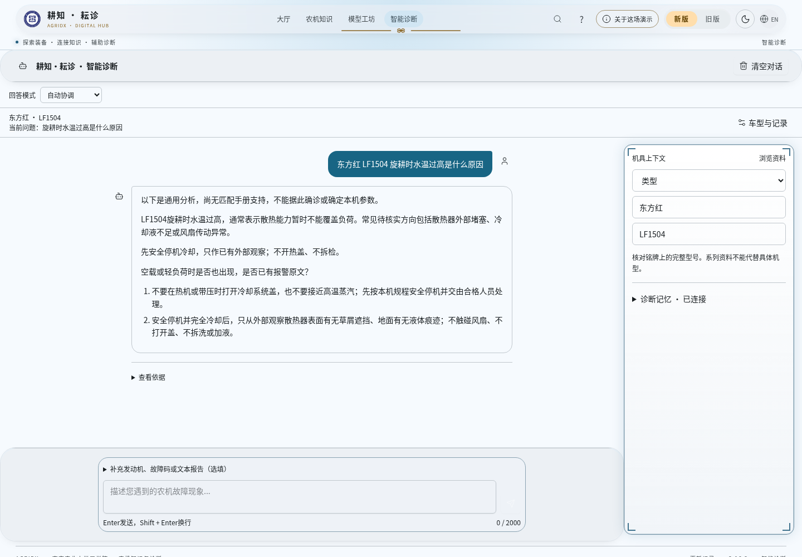

# 智能诊断聊天正文简化（3.16.2）

2026-10-24，基于 main `a928a45`（3.16.1）。PR #102 已合并，复用其结构化答复、安全门、四层检索与协调逻辑。未合并 PR #100 涉及前端目录整理；本批不搬目录，不采用其旧配置。PR #85 和恢复分支保留。

## 界面对比

问题：**东方红 LF1504 旋耕时水温过高是什么原因**。

以下截图使用同一模拟模型回答，实际浏览器调用本地 HTTP 服务及真实知识索引。新界面由本地生产构建提供；未发布。**不是 DeepSeek/Gemini 真实模型测试，不用截图里的模拟分析证明维修结论正确。**

| 视口 | 修改前 | 修改后 |
| --- | --- | --- |
| 桌面 1440×1000 | [原图](before-desktop.png) | [原图](after-desktop.png) |
| 手机 390×844 | [原图](before-mobile.png) | [原图](after-mobile.png) |

修改前：重复描述问题，依次堆放“通用原理参考”“AI 补充分析”“建议先做”，正文再附 TK 编号、长核验说明、来源摘要和技术详情计数。

修改后：自然段直接呈现分析，必要的安全建议使用有序列表，保留简短追问。来源与技术记录集中到气泡外默认收起的“查看依据”，入口不显示数量。用户问题气泡补充明确背景色，避免浅色主题下对比度不足。

## 展示边界

| 信息 | 普通聊天正文 | 后台/依据详情 |
| --- | --- | --- |
| 用户问题、诊断解释、可能原因、安全建议、简短追问 | 保留，Markdown 排版 | 原始答复继续保存 |
| 模型调用失败、未启用 AI、无直接资料、安全核查拒绝 | 保留简短且真实的说明，不伪装成模型已回答 | 保留原始原因与审查记录 |
| 来源编号、页码、适用车型/发动机/故障码、核验原文 | 不默认展示 | “查看依据”保留 |
| 命中数、匹配分数、路由、供应商/模型名、trace、roleFlow | 不默认展示 | 原有结构与详情保留 |
| “【服务状态】”“【协调决策】”等历史内部栏目 | 前端展示过滤，诊断内容/安全禁令保留 | 历史原文不改，仍可展开全文 |

没有新增模型调用，没有改变请求、服务端响应协议、日志、历史保存或记忆格式。三种模式开关、仅知识库禁用外部调用、安全门及来源验证仍由现有服务端执行。前端不生成新的故障原因或车型参数，也不把没有来源的旧文字伪造成结构化证据。

结构化 AI 内容使用已通过安全门的 `aiSupplement`；减少重复的模板解释、独立背景段落及记录提示。已核对的本地原因、安全禁令与安全观察建议仍可呈现。无匹配手册时保留通用分析边界，不把通用资料当作本机确诊。历史非结构化消息只按明确内部栏目/字段进行显示投影，原文继续保存；请求错误保持可见。

## 实现与验证

- `src/features/chat/answer-presentation.ts`：纯显示投影，不变更消息对象；保留实际错误、资料不足与安全提示。
- `src/features/chat/DiagnosticAnswer.tsx`：正文 Markdown、可点击追问和外置折叠依据；展开不发请求。
- `src/pages/ChatPage/ChatPage.tsx`：复用会话功能，连接两个展示组件，删除默认技术状态栏。
- `src/premium-workspace.css`：两种页面外壳的聊天可读性、列表与触控入口。
- `tests/chat-answer-presentation.test.ts`：正文内容、不可变性、失败/无证据、旧格式、数值/故障码、追问上限及安全禁令回归。

执行 `npm run verify` 运行 Python 工具回归、TypeScript 测试、三份类型检查、Lint 和前后端构建。独立展示测试也可用 `node --import tsx --test --test-isolation=none tests/chat-answer-presentation.test.ts` 执行。

[浏览器验收记录](browser-result.json) 包含实际显示文字。已检查精确验收问题、第二轮补充草屑、历史恢复、新旧版页面、桌面/移动布局无横向溢出及输入框处于可视区；来源详情默认关闭、位于气泡外，展开后可见真实来源和模拟模型标识，展开不会新增模型调用。没有真实外部模型密钥，因此不声称完成真实模型质量验收。

本批只改显示层；不能保证任意旧版自由文本都能可靠分离技术记录与维修正文。识别不到的内容不进行激进删改，管理员可展开原始答复核查。模型自身写出的长篇分析也不会通过前端任意截断，以免切断安全前提；后续若仍有冗长个例，应另行依据实际回复调整提示词，不在本批重写协调系统。
