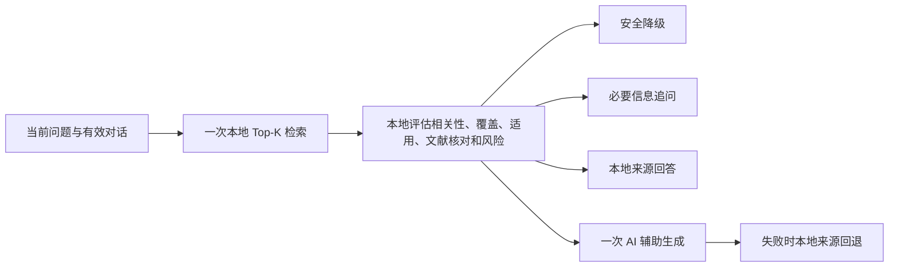

# V3.6.0 诊断路由与验证

## 后续参与者：Planner与执行反馈

本文主体保留原路由实现与性能记录的历史语境；当前交互和输出约束另见[诊断交互](diagnosis-interaction.md)及[专项协调审查](diagnosis-coordination-audit.md)。共同设计依据为[Agent指南](agent-development.md)，不得把下方旧数量或历史验收作为当前线上证据。

现有Planner是本地规则协调：`service.ts`解析上下文、复用一次主要检索，经`coordination.ts`调用`DiagnosisRouter.decide`，再生成、检查并返回答复。供应商回退是受控容错，不是模型自主重规划。下一轮用户报告可以改变路径，但尚无通用模型多步工具循环。

修改规划时先写清输入状态、动作依据、预期观察、停止/追问条件和失败分支。后续若新增循环，显式约定步数、重试、超时与取消；用实际工具结果推进，不把建议当已执行。保留服务端配置、机型适用范围、来源和维修风险门控；模型选择路径或工具输出均不能绕过它们。PR应验证成功路径及本次改动涉及的缺资料、型号纠正、高风险、供应商失败等分支。

3.5.0 已将本功能与最新知识及共享快照统一整合；下文 3.6.0 和性能输出为原分支开发时的历史编号，保留实际测量语境。见[整合验收](integration/20261016-all-open-prs.md)。

本轮以 2026-10-13 主线 `aa6f3db`（3.5.1）为基线。任务原编号为 V3.0.3，用户确认递进为 V3.6.0，保留已合入的诊断记忆、知识扩充、主题和开发控制台。此前协调功能已经支持三种模式、严格原文查阅和提供商失败回退；本轮完善多维证据判断及维修风险路由，没有训练模型、增加依赖或重建知识库。

Express `/api/chat` 调用 `createDiagnosticService`，统一通过 `DiagnosisRouter.decide` 决策。项目原有 TypeScript 进程执行本地计算，避免额外启动 Python 或使用模型评分。

用户已否定旧机型且身份未补齐时，检索次数为零，先追问；这是防止再次引用旧资料的明确例外。其他有效请求只执行一次主要检索；决策、提示词、失败回退都复用该结果。

## 规则与适用边界

- 相关性沿用中文 bigram／英文 token 加权重叠：标题权重 3、正文权重 1，症状同义词权重 0.65。结果未经校准，使用原始阈值，不转成百分比，也不代表故障诊断准确率。
- 导入时解析已有故障现象、可能原因、检查和维修内容，预处理覆盖标签及检索文本。资料缺口、保养主题占位和通用信息收集模板不会被计为完整故障证据。根据当前问题选择必要字段，单问原因不要求维修字段。
- 延用现有完整型号、品牌、排放、CAB／ROPS、2WD／4WD过滤，再核对发动机和故障码的可选元数据。当前 1,213 条归档没有结构化发动机／故障码适配字段，缺项判为未知，不虚构匹配。未知配置、市场或版次限制仍会阻止直接维修回答。
- `referenceVerification=verified` 仅指引用原文或页面图像的文献核对；不等于厂家复核、全书审校或实车验证。未核验、待核验、含否定的状态不会成为直接依据；失败来源从回答和 AI 上下文中排除。本地模式对适用或核验不明的资料只显示来源及限制，不展示其操作正文。
- 制动、转向、PTO、高压、飞车失控、绕过联锁等问题在全部模式下返回有限安全答复，即使有已核对资料也不展示危险拆解、调压或试操作。风险未知的具体维修操作请求同样受限。高风险不会因缺少车型或选择 AI 模式而降低等级。
- 自动模式只有高相关、所需内容覆盖、明确适用且文献已核对的单一充分来源才能直接回答；多条充分资料需要进一步综合。同一编号的原件／版本／定位／正文矛盾会被排除并追问。本轮不进行自然语言语义矛盾检测，不能声称自动完成所有手册间的审校。
- 仅知识库模式不调用外部模型。AI 辅助模式保留安全和来源过滤，跳过自动直答选择；只调用现有 DeepSeek／Gemini 生成模块，主选失败且另一家已配置时最多切换一次，最多一次成功生成。没有额外模型分类或评分请求。

## 配置与缓存

| 配置 | 默认值 | 含义 |
| --- | --- | --- |
| `DIAGNOSIS_TOP_K` | 5 | 检索候选数，允许 1–20 |
| `DIAGNOSIS_RAW_HIGH_THRESHOLD` | 8 | 高相关原始重叠阈值 |
| `DIAGNOSIS_RAW_MEDIUM_THRESHOLD` | 3 | 中相关原始重叠阈值；低于该值不作为证据 |
| `DIAGNOSIS_CONTEXT_MAX_CHARS` | 8000 | 知识上下文字符预算，允许 1000–32000 |
| `DIAGNOSIS_LOG_DECISIONS` | true | 不含原问题或用户检查报告的路由日志 |

原有 `DIAGNOSIS_MODE`、`ALLOW_EXTERNAL_AI` 和提供商配置继续生效。无效路由阈值或模式配置按仅本地处理。以上相关性阈值是可配置的初始工程值，未作临床式准确率校准。

缓存只保存公开、静态的知识片段，不保存问题明文、用户历史或生成答案。键为问题与设备条件、知识重载代次、公开权限范围的 SHA-256 摘要；发动机、故障码条件也参与。有效期 30 秒、最多 128 项，重载知识库时清除；返回对象复制，防止调用者修改共享缓存。若未来引入非公开知识，需要增加真实的权限分区。浏览器开发预览没有 Node 哈希接口时禁用该缓存，继续执行同样的检索与安全路由，不使用弱哈希或保存问题明文。

知识上下文按完整片段取舍，来源编号、页码、状态、适用条件和正文一起计入预算；不会截断片段尾部的安全限制。单条超预算即整条省略，实际发送的编号记录在 `diagnosisTrace.sentKnowledgeIds`。该预算针对知识上下文，系统规则和有界对话／记忆另行保留；不是整个请求的 Token 保证。

## API 与记录

保留现有请求字段和 OpenAI 兼容的 `choices` 响应。可选 `engineModel` 为最多100字符文本，`faultCodes` 为最多20条、各最多32字符的非空文本数组；这些信息送入匹配和 AI 上下文，不代替厂家故障码资料。

`coordination` 返回请求／有效模式、最终路径、原因、风险、所需覆盖、候选原始分数、机型匹配、文献状态、排除与直接依据编号。界面继续显示简洁 `coordinationMessage` 和来源，无新增评分等待界面。

`diagnosisTrace` 返回检索次数、外部生成尝试／成功次数、实际成功提供商、发送的知识编号／字符数，以及检索、决策、外部调用和总耗时。实际提供商失败时成功次数为零；两家失败时尝试次数为二。路由日志通过 `setImmediate` 在答复之后投递，含请求／有效模式及同样的脱敏候选评估，日志失败不影响答复。管理员可查后台日志；本轮没有新建管理可视化系统。

当前 Express API 为非流式 JSON；本轮保留原协议。独立开发预览复用相同规则进行浏览器本地诊断，继续禁止外部模型；计时使用标准 performance，日志在浏览器下一任务投递。不代表已部署 Express 或接通外部模型。本轮仅提交 PR，未更新腾讯或开发站。

## 实测方法与结果

修改前后基于相同 1,213 条归档、1,222 个片段、8组固定问题和同一环境比较。每场景预热20次、有效样本120次；单并发测本地检索、决策、服务、真实 Express localhost HTTP，并统计 P50／P95及生成次数。冷请求在每次请求前清除检索缓存；热请求重复同一问题。基线使用独立工作树中的原提交，避免将修改后的代码误作基线。

模拟提供商只返回固定测试文本，外部计时测的是进程内模拟，不是 DeepSeek／Gemini 的网络延迟。本环境没有这两家可用凭据，真实外部 API 耗时未测。10ms 是本地决策目标，不能据本机结果承诺部署端延迟。

可复现脚本及原始数据：

- [性能脚本](../scripts/benchmark-diagnosis-router.ts)
- [修改前数据](performance/2026-10-13-diagnosis-router/baseline.json)
- [修改后数据](performance/2026-10-13-diagnosis-router/after.json)

| 固定场景 | 修改前服务 P50 / P95 | 修改后冷请求 P50 / P95 | 修改后热请求 P50 / P95 | 路径 |
| --- | --- | --- | --- | --- |
| matched-start-auto | 10.018 / 11.526 ms | 9.967 / 10.855 ms | 1.520 / 1.749 ms | ai |
| yto-starter-auto | 9.389 / 10.020 ms | 9.581 / 9.912 ms | 1.443 / 1.631 ms | ai |
| matched-runaway-auto | 9.374 / 9.719 ms | 9.272 / 9.780 ms | 1.195 / 1.289 ms | safe |
| matched-start-local | 10.293 / 11.851 ms | 9.878 / 10.297 ms | 1.436 / 1.646 ms | local |
| matched-start-assisted | 9.726 / 10.705 ms | 9.578 / 9.875 ms | 1.442 / 1.643 ms | ai |
| unknown-brake-risk | 9.824 / 10.322 ms | 9.588 / 10.021 ms | 1.149 / 1.245 ms | safe |
| missing-code-identity | 9.906 / 10.719 ms | 9.711 / 11.053 ms | 1.171 / 1.245 ms | clarify |
| real-reference-lookup | 9.922 / 10.475 ms | 10.146 / 10.993 ms | 1.798 / 1.995 ms | ai |

上述均为本机服务计算及模拟提供商耗时，不是外部网络生成延迟。每场景120次，纯路由与冷/热结果分别记录；冷请求部分场景略慢，主要收益来自缓存。基线服务保留原Top-6，修改后服务按要求Top-5；独立检索比较均使用Top-5。相同960个服务测量请求的模拟成功生成次数720→480，两类高风险场景从每请求1次降为0次；额外预热、HTTP与冷测组另行计数，不能当作整次脚本总调用数。真实外部API调用均为0。

充分且明确适用的自动本地回答使用合成审校来源做功能测试；8个真实归档场景中的资料仍存在核验或适用缺口，未强行标为足够，原文查阅样例仍走AI。实际localhost请求与完整响应见[执行路径](performance/2026-10-13-diagnosis-router/execution-paths.json)，包括一次检索、来源、候选评估、追问/安全分支和调用计数。

## 最终本地验收

- `npm ci` 从官方 registry 安装597包，保持原锁文件完整性与依赖版本；原镜像不可达时仅本次命令切换下载入口，不修改全局配置。
- `npm run verify` 完整通过：271项中269项成功、2项Windows专用检查在Linux跳过；版本、前后端类型、所有回归、lint和生产前后端构建完成。保留既有按钮Fast Refresh及Three.js较大chunk提示，无lint错误。
- 实际Vite开发预览构建测试通过，独立检查动态计时的有限非负值，其余Node／浏览器答复保持一致；浏览器外部生成次数为零。
- 索引校验26来源、1213归档、1222片段，0错误；没有修改知识事实、PDF原件或依赖版本。
- 生产模式真实Express监听执行12项HTTP检查：三模式来源、三模式制动安全、代码缺身份追问、否定旧机型暂停检索、输入校验及目录；全部通过，实际外部API调用0。见[生产模式HTTP回执](performance/2026-10-13-diagnosis-router/production-http.json)。
- [验收数据](performance/2026-10-13-diagnosis-router/validation.json)保存结果及范围；本轮仅PR审阅，没有服务器／开发站部署或实车验证。

实现与验收提交：[ebe6f2d](https://github.com/srt2777/AgriDx-v3/commit/ebe6f2d2fa76cdee7b188ae0c40b310ebb5683af)。性能数据中的rootCommit为采样时基线，measuredSourceSha256绑定当时工作树中的实际实现；本提交的相关源码指纹与最终数据一致。
