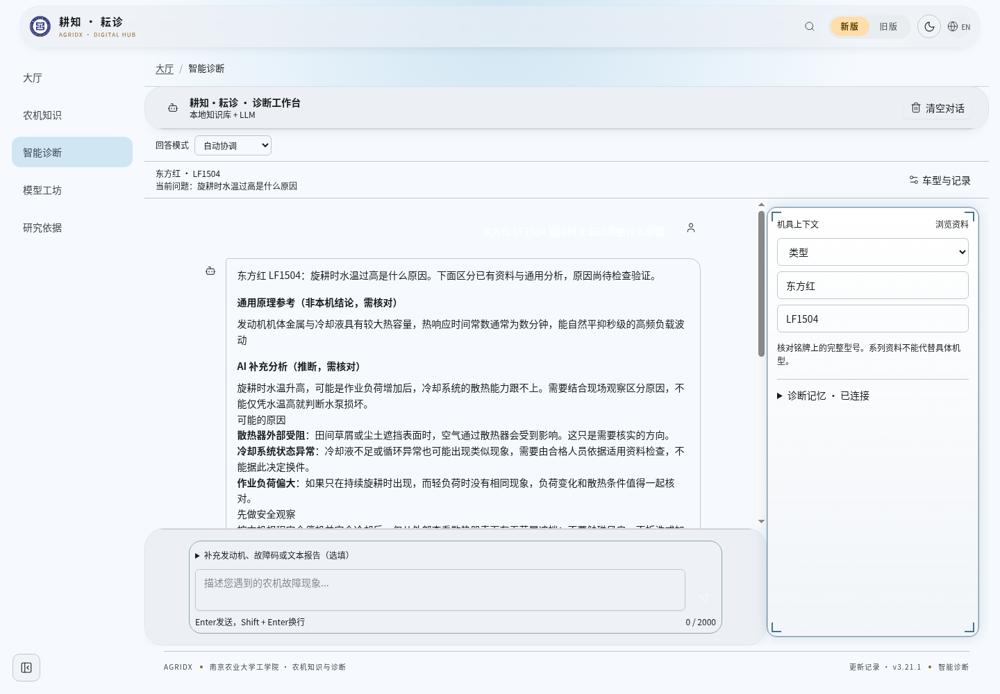
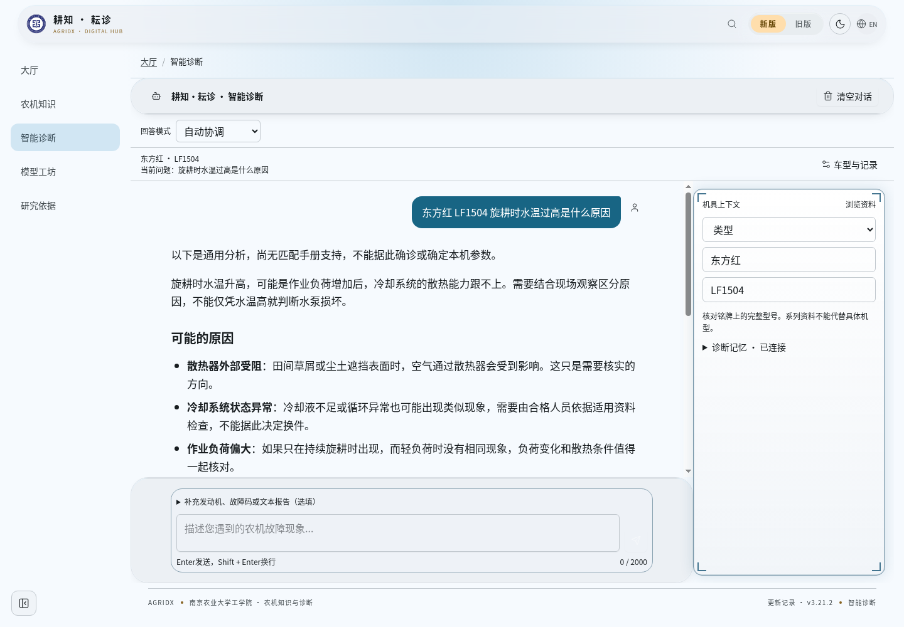

# 诊断聊天阅读优化 · 3.21.2

基于 2026-10-25 main `ae75681`（3.21.1）。当前 PR #109 尚未合并，本批复用它已完成的前端正文投影、依据折叠与12项测试，不重复实现协调或安全门，不迁入其旧版本配置。原 PR #109、恢复分支及其他未合并 PR 保留；新 PR 覆盖 #109 的前端功能，审阅者可协调保留哪一份，不能同时重复合入旧版本记录。

已检查 #100（UI目录整理）、#124（新版风格）和 #125（开发站AI接入）的改动范围。本批使用最新主线目录，不搬文件、不引入其未合并的后端/部署改动；只调整聊天展示及局部样式。

## 前后截图

固定问题：**东方红 LF1504 旋耕时水温过高是什么原因**。

同一份明确标记的模拟模型回复，经过本地真实 HTTP、现有检索/协调/安全门，再由生产构建页面渲染。截图用于比较界面，**不是 DeepSeek/Gemini 真实模型验收或维修准确率证明**。布局压力样本另标为合成文本，不用于安全门或模型效果评估。

| 尺寸 | 修改前 | 修改后 |
| --- | --- | --- |
| 桌面 1440×1000 | [截图](before-desktop.png) | [截图](after-desktop.png) |
| 手机 390×844 | [截图](before-mobile.png) | [截图](after-mobile.png) |




## 实际测量

| 项目 | 原 main | 修改后 |
| --- | --- | --- |
| 桌面正文 | 14px，行高22.75px | 17px，行高28.9px（1.7） |
| 手机正文 | 14px，行高22.75px | 16px，行高27.2px（1.7） |
| 标题 | 14px，层次不明显 | 桌面20px、手机18px，字重600 |
| 用户消息 | 14px | 16px |
| 输入框 | 桌面14px、手机16px | 全部至少16px，包括旧版设备输入 |
| 段间距（测量段落） | 0 | 桌面15.3px、手机14.4px |
| AI布局 | 带边框的卡片、重复技术栏目 | 透明开放正文、简洁复制按钮，依据默认收起 |
| 桌面正文最大宽度 | — | 752px文字区，外层含边距不超过800px |

采用本机中文系统字体栈，不下载远程字体；正文400字重，加粗及标题600。新旧页面各自外壳保留，旧版14px强制重置只在聊天内容范围内覆盖。移动输入区压缩装饰性边距；聊天路由手机页脚保留版本链接，避免重复院校标识占据阅读高度，导航及其他页面不改。

## 保留的能力与隐藏边界

- 本地知识、DeepSeek/Gemini调用、三种路由模式、安全门、上下文、来源追踪、核验状态、日志、历史保存与协议均未修改。
- 来源编号、来源适用范围、评分、命中数、模型名、路由、审查记录及原始答复继续保存在原有数据结构，默认不进入正文；气泡外“查看依据”可展开。
- 资料不足、AI失败及安全禁令仍有必要的用户提示，不把通用分析当作本机确诊。复制仅取显示正文，不复制隐藏技术元数据。
- Markdown段落、加粗、标题、两类列表正常显示。长链接和代码自然换行，表格在内容区内折行，不让页面产生横向滚动。
- 没有增加LLM调用，也没有新增远程依赖、生产开关、数据库迁移或知识事实修改。

## 测试结果

- `npm run verify`：645项测试，643通过、2项平台跳过、0失败；Python工具回归、三份TypeScript检查、Lint、前后端完整构建通过。
- 正文/答复专项：20项全部通过；保留安全禁令、故障码、失败说明和原始元数据不可变性检查。
- 最后移动端间距及输入字号调整后重新执行前端构建和浏览器验收；无运行时异常。
- 浏览器实测：新版1440/390/320px、旧版1440/390px，正文/标题/输入字号正确；无页面横向溢出，输入框在可视范围内。
- 3586字、24个段落的合成长回答，在1440px与320px宽度下检查全部后代元素，无横向溢出；覆盖长字符串、长链接、表格和代码块。
- 真实页面切换：自动模式调用模拟提供商；仅知识库0次外部尝试；AI辅助1次外部尝试。此处的“外部”是注入的受控模拟提供商，未向真实模型API发请求。
- 复制后读回剪贴板，内容正确且不含技术字段；展开依据可见真实来源与模拟模型标识，展开不新增模型调用；旧版重载后对话保留。
- 原有按钮Fast Refresh警告及大分包提示保留，未扩大本批范围。

详见机器可读的 [修改前结果](before-browser.json) 与 [修改后结果](after-browser.json)。

## 复跑浏览器检查（本地QA，不对生产站执行）

要求 Node、项目依赖和 Chromium 已安装。QA服务仅监听 `127.0.0.1`，固定注入模拟提供商；SQLite和检查产物默认存于操作系统临时目录的 `agridx-chat-reading-qa`，不写知识原件。测试脚本不进入前后端发布产物。

```bash
npm run build
# 终端1：这里的production仅指使用本地dist，不部署
NODE_ENV=production node --import tsx scripts/qa/chat-reading-server.mjs 4411 after
# 终端2
chromium --headless --no-sandbox --disable-dev-shm-usage --remote-debugging-port=9228 --user-data-dir=/tmp/agridx-chat-reading-chromium about:blank
# 终端3
node scripts/qa/chat-reading-browser.mjs after 4411
```

可通过 `CHAT_QA_OUTPUT_DIR` 和 `CHAT_QA_CDP_PORT` 指定临时产物目录和调试端口；PowerShell使用 `$env:NODE_ENV='production'` 等环境变量语法。运行后停止本地QA服务和Chromium。需要比对原main时，在独立工作树构建上述基线，再以 `before` 标签和独立端口启动相同QA服务与浏览器脚本；不要覆盖当前工作区。

本批仅提交分支与PR，不自动合并或部署。
