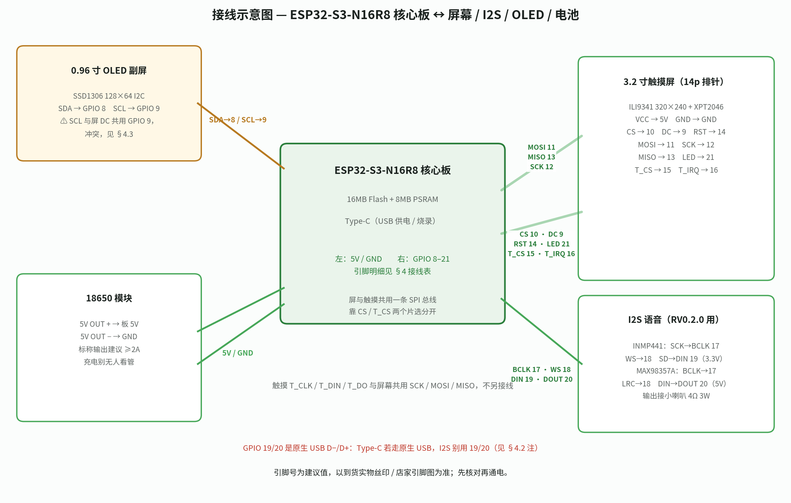
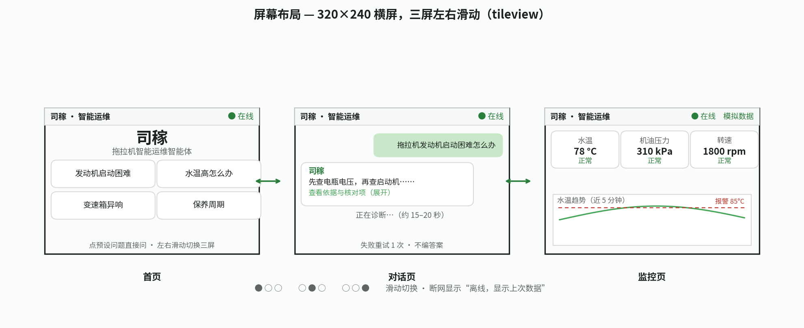
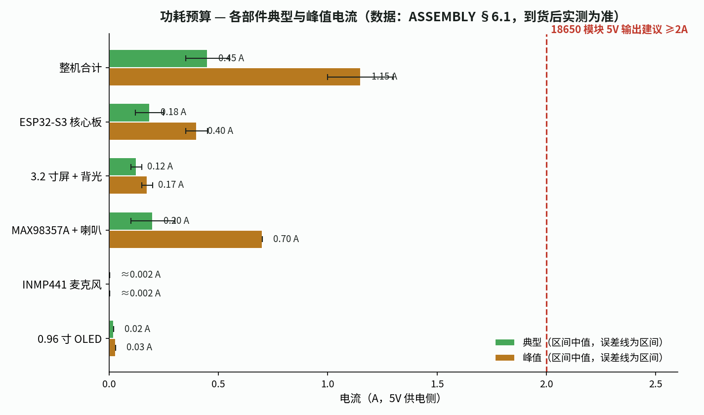

# 司稼小机器人 RV0.1.0 — 组装指南

> 对应方案：`robot/versions/v0.1.0.md`（§2 硬件、§2.2 接线、§2.3 显示两规格、§2.4 二期底盘）。
> 面向在校学生：按顺序做，一步一验。**所有“以实物为准”的地方，到货后先核对再通电。**

---

## 1. 实购清单（2026-11-09 已下单）

| # | 件 | 实购型号 / 店家 | 实付 | 状态 |
|---|---|---|---|---|
| 1 | 主控 | 登仕唐 ESP32-S3-N16R8 核心板（焊好 Type-C 口） | ¥25.48 | 京东，预计 11-10 送达 |
| 2 | 屏幕 | DZYJ 彩色液晶屏模块，3.2 寸触摸屏，SPI 14p 排针 | ¥34.69 | 京东，预计 11-10 送达 |
| 3 | 功放 | MAX98357A I2S 功放（PH2.0 插头） | ¥9.9 | 拼多多，打包中 |
| 4 | 麦克风 | INMP441 全向 MEMS 麦克风，I2S 接口（排针已焊） | ¥8.8 | 拼多多，打包中 |
| 5 | 电源 | 18650 锂电池模块 + 电池 | ¥27.8 | 拼多多，打包中，承诺后天送达 |
| **合计** | | | **¥106.65** | |

### 还缺（订单里没有，演示前补齐）

| 件 | 规格 | 参考价 | 用途 |
|---|---|---|---|
| 小喇叭 | 4Ω 3W | 约 ¥5–10 | 接 MAX98357A 输出，语音播报 |
| 杜邦线 / 排线 | 母对母、母对公各一包 | 约 ¥5–10 | 屏 14p 排针、麦克风、功放都要线连到核心板 |
| 外壳 / 底座 | 3D 打印或亚克力板 + 铜柱 | 约 ¥30–60 | 按 3.2 寸屏开孔固定 |

### 关键参数（以到货实物为准）

- **核心板**：N16R8 = 16 MB Flash + **8 MB PSRAM**（LVGL 双缓冲和字库就靠它）。
- **屏幕**：3.2 寸 SPI 触摸屏，**大概率 ILI9341、320×240、XPT2046 电阻触摸**——以到货实物丝印和店家资料为准。**不是原方案的 3.5 寸 480×320**，界面按 320×240 排。
- **电源**：18650 模块带充电 + 5V 稳压输出。**到货核对 5V 输出电流**（见 §2 和 §6 功耗预算）。

---

## 2. 到货验收（三件事，先验后装）

| # | 验收项 | 怎么做 | 不合格怎么办 |
|---|---|---|---|
| 1 | **屏的驱动芯片丝印** | 看屏幕背面主芯片上的丝印（一般是 `ILI9341` 字样），同时对照店家商品页 / 随附资料 | 丝印不是 ILI9341（例如 ILI9488、ST7796）：不要按默认接线烧录，先看 §7 换屏对照表，改 `display_config.h` 再烧 |
| 2 | **核心板引脚图** | 找店家商品页的引脚图（或随板卡片），确认 5V、GND、GPIO 8/9/10/11/12/13/14/15/16/21 的位置；重点确认板上 5V 引脚叫什么（5V / VIN / VBUS 各家写法不同） | 引脚图与 §4 的建议值对不上：以引脚图为准改接线，不要硬套 |
| 3 | **18650 模块 5V 输出电流** | 看模块丝印或商品页的标称输出电流（常见 1A / 2A / 2.4A）；有条件用万用表 / USB 电流表实测带载输出；**升压输出先空载量到 5.0V 左右再接核心板** | 标称 < 2A：先按 §6 算一遍峰值电流；不够就换大电流模块（见 §6.4），不要等整机反复重启才换 |

另外顺手检查：屏幕排针有没有歪针 / 虚焊；18650 电池有没有鼓包、破皮；模块上的电池正负极标识是否清晰。**电池有破损、鼓包直接联系卖家换货，不要用。**

---

## 3. 工具准备

- 电脑（Windows / macOS / Linux 均可）+ Type-C 数据线（能传数据的，不要只充电的线）
- 杜邦线、万用表（测电压、通断）、小十字螺丝刀、绝缘胶带 / 热缩管
- 烧录软件见 `FLASHING.md`；本指南只讲硬件组装

---

## 4. 接线表（信号级）

> **总原则：信号一一对应，电源先核对电压再接。所有 GPIO 号都是建议值，以到货实物丝印 / 店家引脚图核对为准。**
>
> 接线总览见 。
>
> 注意：GPIO 26–32（Flash / PSRAM）与 33–37（Octal PSRAM 扩展线）不可作普通 IO；ESP32-S3 没有 GPIO 22–25，不要按旧 ESP32 的引脚图找这几个号。当前引脚（8–21）均未踩这些禁区，也未踩 strapping 引脚（GPIO 0/3/45/46）。

### 4.1 屏幕 14p 排针 → ESP32-S3 核心板

屏幕是 14p 排针，信号为：VCC、GND、CS、RESET、DC、MOSI、SCK、LED、MISO、T_CLK、T_CS、T_DIN、T_DO、T_IRQ。

| 屏幕排针信号 | 接核心板 | 说明 |
|---|---|---|
| VCC | 5V | 屏供电。**模块自带稳压，以实物说明为准**：如果实物说明写 VCC 接 3.3V，就接 3.3V，不要接 5V（有同款 ILI9341 项目屏接 3.3V，不要想当然接 5V） |
| GND | GND | 共地，所有模块的 GND 都要连在一起 |
| CS | GPIO 10（TFT_CS） | 屏幕片选 |
| RESET | GPIO 14（RST） | 屏幕复位 |
| DC | GPIO 9 | 数据 / 命令选择 |
| MOSI | GPIO 11 | SPI 主出从入 |
| SCK | GPIO 12 | SPI 时钟 |
| LED | GPIO 21（BL） | 背光，接 PWM，可调亮度；也可先直接接 3.3V 常亮，调光以后再说 |
| MISO | GPIO 13 | SPI 主入从出 |
| T_CLK | GPIO 12 | 触摸时钟，**与屏幕 SCK 共用同一根线** |
| T_CS | GPIO 15 | 触摸片选（与屏幕 CS 分开） |
| T_DIN | GPIO 11 | 触摸数据入，**与屏幕 MOSI 共用同一根线** |
| T_DO | GPIO 13 | 触摸数据出，**与屏幕 MISO 共用同一根线** |
| T_IRQ | GPIO 16 | 触摸中断（触摸时拉低通知主控） |

要点：

- 屏幕和触摸**共用一条 SPI 总线**（MOSI / MISO / SCK 三根线各只接一次），靠 CS（GPIO 10）和 T_CS（GPIO 15）两个片选分开选通。不要把 T_CLK / T_DIN / T_DO 另接三根线。
- SPI 频率固件里默认 40 MHz。**注意：40 MHz 是超 ILI9341 数据手册标称（写操作上限 10 MHz）的超频常用值**，短线通常能跑；花屏时先降到 10 MHz 验证，确认屏体质后再逐步上调（见 `FLASHING.md` 故障表）。
- 本固件从不读屏（只写），触摸读数只走 T_DO。若触摸读数乱跳而屏幕正常，查 MISO 线：个别 ILI9341 模块的 SDO 在 CS 拉高后不完全高阻，会与触摸 T_DO 冲突——可把屏的 MISO 脚悬空，只留 T_DO 接 GPIO 13。
- 接线长度尽量短（杜邦线 10–20 cm 内），太长 SPI 信号会不稳。

### 4.2 I2S 语音：INMP441 麦克风 + MAX98357A 功放

| 模块 | 信号 | 接法 | 供电 |
|---|---|---|---|
| INMP441 | SCK | BCLK（与功放共用） | 3.3V |
| INMP441 | WS | WS / LRC（与功放共用） | 3.3V |
| INMP441 | SD | DIN（麦克风数据入） | 3.3V |
| INMP441 | GND | GND（共地） | — |
| MAX98357A | BCLK | BCLK（与麦克风共用） | 5V |
| MAX98357A | LRC | WS / LRC（与麦克风共用） | 5V |
| MAX98357A | DIN | DOUT（功放数据出） | 5V |
| MAX98357A | GND | GND（共地） | — |
| MAX98357A | 输出 + / − | 接小喇叭（4Ω 3W）两端 | — |

要点：

- 麦克风和功放**共用 BCLK 和 WS 两根时钟线，数据线分开**（DIN 接麦克风、DOUT 接功放），这是 I2S 的标准接法。
- **⚠ I2S 引脚待改（RV0.2.0 前必须改，代码改动，编译进行中时不要动）：**`display_config.h` 里 DIN / DOUT 现在是 GPIO 19 / 20，但这两个脚是 ESP32-S3 原生 USB 的 D− / D+。若登仕唐板的唯一 Type-C 走原生 USB，RV0.2.0 一启用 I2S 就会断烧录与串口；若 Type-C 是经 CH340 / CP210x 桥接芯片转串口，则可用。**到货先查明 Type-C 走哪种，再决定；若走原生 USB，把 DIN / DOUT 移到空闲 GPIO（如 38 / 47，核对引脚图确认未被板载外设占用），同步改 `display_config.h`。**RV0.1.0 不用 I2S，本版不受影响。
- I2S 的 GPIO 号以固件工程的引脚定义为准（`display_config.h`：BCLK 17、WS 18、DIN 19、DOUT 20），布线前先打开固件核对，不要自己编一组。共用 BCLK / WS 出现杂音时的后备方案：把麦克风与功放拆到两路 I2S 总线（各用自己的 BCLK / WS）。
- INMP441 用 3.3V 供电，MAX98357A 用 5V 供电（5V 下喇叭声音更大）。MAX98357A 的 SD（关断）引脚按模块说明处理：Adafruit 板靠板载上拉默认开启，裸片 / 其他模块悬空行为不确定，以实物为准。
- 小喇叭线不要和麦克风线捆在一起，喇叭大声时会串进麦克风（啸叫 / 回声）；**麦克风与喇叭保持 5 cm 以上距离**。

### 4.3 0.96 寸 OLED 副屏（SSD1306，I2C）

| OLED 引脚 | 接核心板 | 说明 |
|---|---|---|
| VCC | 3.3V | OLED 用 3.3V，不要接 5V |
| GND | GND | 共地 |
| SDA | GPIO 8（建议，待核对） | I2C 数据 |
| SCL | GPIO 9（建议，待核对） | I2C 时钟 |

要点：

- **⚠ SCL 撞引脚，必须改（代码改动，编译进行中时不要动）：**`display_config.h` 里 `PIN_TFT_DC` 与 `PIN_OLED_SCL` 都是 GPIO 9，主屏和 OLED 不能同时用。修复：把 OLED 的 SCL 移到空闲 GPIO（如 GPIO 7，核对引脚图确认未被占用），同步改 `display_config.h` 里的 `PIN_OLED_SCL`。RV0.1.0 主固件不含 OLED 代码，本版不受影响；写 OLED 版固件前必须先改好。
- GPIO 8/9 是建议值，**以核心板引脚图为准**。
- I2C 地址常见 0x3C（部分模块是 0x3D），以实物丝印 / 固件扫描结果为准。
- OLED 是单色黑底白字，只放状态和简短问答（见方案 §2.3），不画表盘和曲线。

### 4.4 供电接线：18650 模块 → 整机

| 模块 5V 输出 | 接核心板 | 说明 |
|---|---|---|
| 5V OUT + | 核心板 5V 引脚（5V / VIN，以引脚图为准） | 给整机供电 |
| 5V OUT − | GND | 共地 |

要点：

- **电池正负极不要接反**：先看模块上的 + / − 标识，接反会烧板。模块一般带保护板，但不要依赖它防呆。
- 屏、功放的电源都从核心板 5V 取，不要从模块另拉一路（共地会乱）。
- 18650 充电时**不要无人看管**；不要边充电边满功率播报（看模块说明是否支持边充边放）。
- **烧录 / 调试时先断开 18650 模块的 5V 输出线，只留 USB；演示用电池时再拔 USB。除非已确认核心板有电源路径隔离，否则两路 5V 不许并联**（并联可能倒灌烧板）。

---

## 5. 组装顺序（先点亮屏幕，再接外设）

按这个顺序做，每步验证通过再做下一步，出问题只可能是刚加的那一步。

| 步骤 | 做什么 | 验证标准 |
|---|---|---|
| 1 | **到货验收**（§2 三件事） | 驱动丝印、引脚图、模块电流都确认了 |
| 2 | **只接核心板**：Type-C 连电脑，不接任何外设 | 电脑识别出串口；烧录一个最小程序（见 `FLASHING.md`），串口有打印 |
| 3 | **只接屏幕**：按 §4.1 接 14p 排针，烧录固件 | 屏幕点亮，显示首页（司稼标题 + 预设问题）；触摸预设问题有反应 |
| 4 | **调触摸**：点屏幕四角和按钮 | 触摸位置对得上（见 `FLASHING.md` 触摸不准一条） |
| 5 | **接 OLED 副屏**（如已买到）：按 §4.3 接 I2C，通断与 3.3V 供电检查 | 线通、无短路；显示功能等 OLED 版固件（RV0.1.0 主固件不含 OLED 代码） |
| 6 | **接 I2S 麦克风 + 功放**（先不接喇叭）：按 §4.2 接，通断与供电检查 | 线通、无短路；麦克风 3.3V、功放 5V 正常；功能验证等 RV0.2.0 语音固件 |
| 7 | **接小喇叭**：量阻抗 4Ω、检查短路 | 阻抗对、无短路；出声验证等 RV0.2.0 语音固件 |
| 8 | **接 18650 模块供电**：断开 USB，模块 5V 供整机 | 整机正常开机、问答、监控；测整机电流（§6） |
| 9 | **整机联调**：跑方案 §4 流程（开机 → 联网 → 自检 → 问答 → 监控） | 问答约 15–20 秒出答案；监控表盘动；断网有“离线”提示 |
| 10 | **装外壳 / 固定**：屏幕开孔、铜柱固定、线用扎带理好 | 屏幕不晃、线不压到排针、电池固定不晃动 |

注：RV0.1.0 没有屏上触摸校准界面，标定靠手填 `display_config.h` 里的四个常数（点四角、看串口原始值再填）。改进方向（RV0.1.1）：首次开机跑四点标定（点四个靶点），结果存 NVS，下次开机直接用，手填常数只作后备（同类项目 Car-Dashboard-ESP32-CYD 就是这么做的）。三屏布局见 。

---

## 6. 功耗预算与供电余量（必读）

> 以下电流是**典型值 / 估算值**（按器件手册典型参数和同类模块实测经验），到货后用 USB 电流表实测整机电流为准。预算的目的是：**换电池、换模块之前，先知道瓶颈在哪。**
>
> 

### 6.1 各部件电流（5V 供电侧）

| 部件 | 典型工作电流 | 峰值电流 | 说明 |
|---|---|---|---|
| ESP32-S3 核心板 | 0.12–0.25 A | 0.35–0.45 A | WiFi 发射瞬间最大；含板载 USB 转串口芯片和指示灯。注：芯片数据手册峰值 355 mA 是 3.3V 侧（802.11b 20.5 dBm）的值，5V 侧预算按此折算并留余量，数值本身偏保守，可保留 |
| 3.2 寸屏（ILI9341 + 背光） | 0.10–0.15 A | 0.15–0.20 A | 背光全亮时最大；背光调暗可省一半 |
| MAX98357A + 4Ω 3W 喇叭 | 0.10–0.30 A（播报时） | 约 0.7 A | 满功率 3W 输出时；平时语音播报音量中等，远不到满功率；静态约 2.4 mA（拉低 SD 关断时才近零） |
| INMP441 麦克风 | 3.3V 下约 2.2 mA | 约 2.5 mA | 可忽略 |
| 0.96 寸 OLED（副屏） | 约 0.02 A | 约 0.03 A | 可忽略 |
| **整机合计** | **约 0.35–0.55 A** | **约 1.0–1.3 A** | 峰值 = WiFi 发射 + 背光全亮 + 大音量播报同时发生 |

### 6.2 续航估算（18650）

| 电芯 | 能量 | 5V 侧可用能量（升压效率约 85%） | 续航（按典型 0.5 A / 2.5 W 算） |
|---|---|---|---|
| 2600 mAh | 3.7 V × 2.6 Ah ≈ 9.6 Wh | 约 8.2 Wh | 约 3 小时 |
| 3400 mAh | 3.7 V × 3.4 Ah ≈ 12.6 Wh | 约 10.7 Wh | 约 4 小时 |

演示 3 分钟 + 彩排，2600 mAh 完全够用；3400 mAh 主要多的是余量。

### 6.3 换 3C 高倍率 18650 电池

**可以直接换，固件不用改。** 关键结论：

- 3C 的意思是放电倍率 3C：一节 2600 mAh 的 3C 电芯，最大放电电流 = 2.6 A × 3 = **7.8 A**，远超整机峰值 1.3 A。**电芯的放电能力不是瓶颈。**
- **真正的瓶颈是 18650 升压模块的 5V 输出电流**。模块标称多少，整机就只能用到多少。选模块认准标称 ≥2A 输出的升压方案（如 MT3608 这类），不要只看电池容量。
- 换电池前核对两件事：① 模块标称 5V 输出电流（建议 **≥ 2A**，留 50% 以上余量）；② 电芯尺寸是标准 18650（直径 18 mm、长 65 mm），带保护板优先。
- **充电时别无人看管**，不要混用新旧电芯，不要用破皮、鼓包的电芯。

| 更换 | 能不能直接换 | 说明 |
|---|---|---|
| 2600 mAh → 3400 mAh | **能** | 同尺寸 18650，容量只影响续航（约 3 小时 → 约 4 小时），电流能力、电压都一样；注意正负极方向 |
| 普通电芯 → 3C 高倍率电芯 | **能** | 放电能力 7.8 A 远超需求；注意 3C 电芯容量通常偏小，续航可能略短；固件不用改 |
| 换更大输出电流的升压模块 | **能** | 模块标称 ≥ 2A 优先；换模块只改供电，固件不用改 |
| 18650 → 两节并联 | 不建议新手做 | 并联要同品牌、同容量、同新旧，否则会互相充电发热；演示没必要 |

### 6.4 18650 模块 5V 输出不足的症状与对策

| 症状 | 可能原因 | 对策（按顺序试） |
|---|---|---|
| WiFi 发射或喇叭大声时突然重启，串口报 `Brownout detector was triggered` | 瞬间电流超过模块输出能力，5V 被拉垮 | ① 大电流负载错峰：先连 WiFi 再播报，背光与播报不同时拉满（同类项目实测错峰可降峰值）；② 降背光亮度（BL PWM 调低）；③ 降喇叭音量；④ 降 WiFi 发射功率（固件可配）；⑤ 换 ≥ 2A 输出的模块 |
| 屏幕闪烁、花屏、触摸失灵 | 供电不稳，纹波大 | 先换 USB 供电验证是不是供电问题；是就换模块或加电容（100–470 µF 电解电容并在 5V 输入端） |
| 反复重启，进不了系统 | 模块带不动整机峰值 | 同上；先拔掉喇叭和副屏，只留核心板 + 主屏，看能不能稳定开机 |
| 临时验证 | — | 用充电宝 / 电脑 USB 供电跑一遍：如果 USB 供电正常、电池供电不正常，问题就在电池模块，不在代码 |

---

## 7. 换屏幕余量（固件用 `display_config.h` 切换）

> 换屏不用重写 UI 代码，改配置档 + 重新烧录即可。配置档在固件工程里（`firmware/rv0.1.0/` 下的 `display_config.h`，以固件工程实际文件为准）。

### 7.1 默认配置

| 项 | 默认值 |
|---|---|
| 驱动 | ILI9341 |
| 分辨率 | 320×240（横屏） |
| 触摸 | XPT2046（SPI 电阻触摸） |
| SPI 频率 | 40 MHz |

### 7.2 换屏对照表

| 屏幕 | 驱动（TFT_eSPI 里选） | 分辨率 | `display_config.h` 要改的项 | UI 是否自适应 |
|---|---|---|---|---|
| ILI9341 3.2 寸（默认） | ILI9341 | 320×240 | 不用改 | 按 320×240 设计，原生适配 |
| ILI9488 3.5/4.0 寸 | ILI9488 | 480×320 | 驱动宏、宽高改 480×320 | **不自适应**：LVGL 布局是按 320×240 固定像素排的，换大屏后能显示但周围留白；要把字号、按钮尺寸按约 1.5 倍放大，或改用百分比布局 |
| ILI9486 3.5 寸 | ILI9486 | 480×320 | 驱动宏、宽高改 480×320 | 同上，需放大布局 |
| ST7796 3.5/4.0 寸 | ST7796 | 320×480（竖屏）或 480×320（横屏） | 驱动宏、宽高、旋转方向 | 同上；注意 ST7796 常见是竖屏模组，横屏用要改旋转 |
| ST7789 2.0/2.4 寸 | ST7789 | 240×240 或 240×320 | 驱动宏、宽高改小 | **要重排版**：屏更小，320×240 的布局放不下，按钮和字号都要缩小 |
| HX8357B 3.5 寸 | HX8357B | 480×320 | 驱动宏、宽高改 480×320 | 同 ILI9488，需放大布局 |
| SSD1306 0.96 寸 OLED | 不走 TFT_eSPI（用 U8g2） | 128×64 | 不是换主屏，是副屏（见 §4.3）；主屏配置不动 | 副屏单独一套 3–4 行布局，见方案 §2.3 |

换屏操作步骤：① 确认新屏驱动丝印 → ② 改 `display_config.h`（驱动宏、宽高、旋转、SPI 引脚）→ ③ 重新编译烧录 → ④ 点亮验证 → ⑤ 触摸校准（见下）。

### 7.3 触摸芯片不同时要改的驱动项

| 触摸芯片 | 类型 | 接口 | 要改的项 |
|---|---|---|---|
| XPT2046（默认） | 电阻触摸 | SPI（与屏幕共用总线） | 不用改；**标定靠 `display_config.h` 里的 TOUCH_X_MIN/MAX 等常数**（到货后点四角、看串口原始值再填，RV0.1.0 没有屏上校准界面）。注：数据手册典型 fCLK 为 2 MHz，2.5 MHz 为常用上限值，`tft_setup.h` 里 `SPI_TOUCH_FREQUENCY 2500000` 与之相符 |
| FT6236 / FT6336 | 电容触摸 | I2C（地址一般 0x38） | 换驱动库（FT6236 库）、I2C 引脚、去掉 T_CS / T_IRQ 接线；电容屏出厂已校准，一般不用手动校准 |
| GT911 | 电容触摸 | I2C（地址 0x5D 或 0x14） | 换驱动库（GT911 库）、I2C 引脚、改 `lv_indev` 注册的驱动；注意地址由 INT 引脚电平决定，以实物为准 |
| CST816S | 电容触摸 | I2C（地址一般 0x15） | 换驱动库（CST816S 库）、I2C 引脚；常见于小圆屏 / 方屏 |

要点：

- 电阻屏（XPT2046）换电容屏，不只是改库：**接线也变了**（SPI 的 T_CS / T_IRQ 不用接了，改接 I2C 的 SDA / SCL），`display_config.h` 里触摸类型和引脚都要改。
- 换触摸芯片后，第一次开机必须做触摸校准（电阻屏）或点四角验证（电容屏）。
- 买新屏时优先选“驱动 + 触摸”都明确标注的型号，不要买只写尺寸不写驱动的。

---

## 9. 下一步：端侧模型预留（RV0.2+，本期只做预留，不做模型）

> 传感器闭环（RV0.1.1）节点本地算特征，未来可把轻量模型下放到 Hub 做端侧诊断。本期只预留，不承诺端侧诊断。

| 预留项 | 做法 | 依据 |
|---|---|---|
| Flash 分区 | 16MB Flash 预留 1MB 模型分区（其余固件 / 文件系统 / OTA），现阶段只放占位文件 | 70.9 KB 的 INT8 模型已在同款 ESP32-S3（16MB Flash + 8MB PSRAM）上实测可跑，1MB 预留有 10 倍以上余量（Kurnianingsih 等，2026） |
| 特征管线 | 节点本地算 RMS / FFT / 峭度 / 1× / 2× / BPFO / BPFI，输出定长特征向量——该向量就是未来模型的输入，管线本身不依赖模型是否存在 | 农机边缘预警论文用同样的 12 维时频特征起步，再融合成 8 维（Li 等，2026） |
| 只传特征 | 节点只上传特征向量，不上传原始波形：12 维 float32 特征 48 字节、8 维 32 字节，可装进 ESP-NOW 250 字节单包；1 kHz 下 1 秒原始波形 2000 字节，传不出去 | 边缘做特征提取、云端做融合与重训的分工（Zhou 等，2026） |
| 体积上限 | int8 模型 ≤100 KB（以 70.9 KB 实测模型为锚点），分区硬上限 1MB，超过的不接受 | 147K 参数教师模型经蒸馏到 33K 参数、INT8 量化压缩 3.98 倍后才得到 70.9 KB，RMSE 只损失 1.6%（Kurnianingsih 等，2026） |
| 部署路线 | 预留两条，不二选一：TensorFlow Lite Micro（esp-tflite-micro + ESP-NN 内核）或 Espressif ESP-DL（`.espdl` 格式，ESP-PPQ 量化） | TFLite Micro 实测（Kurnianingsih 等，2026）；ESP-DL：github.com/espressif/esp-dl |
| 冻结特征定义 | 特征向量定义一旦定稿就冻结版本号，Hub 与云端共用同一份；未来模型上线时只换 Hub 内的推理模块，不改节点采样与组包格式 | 云边协同分工（Zhou 等，2026） |

**本期不做：**① 训好的端侧模型——没有拖拉机故障标注数据，6 周内采数、标注、训练、量化、部署、验证走不完；② 大 Transformer / GRU——TFLite Micro 在 S3 上有 1024 个张量分配上限，GRU 基线已实测失败；③ 1 kHz 采样下 BPFO / BPFI 只作“疑似指示”，不作确诊（Nyquist 500 Hz，高于 500 Hz 的轴承特征频率会混叠）；④ 不要承诺 99%+ 准确率——CNN 离线 99.95%，部署到 ESP32 后实测跌到 94.2%（Cotrino Herrera 等，2026）。

## 10. 安全注意事项

1. **18650 充电别无人看管**；充电时把电池放在防火面上（瓷砖 / 金属盘），不要盖被子、不要放床上。
2. 电池正负极不要接反、不要短路（杜邦线金属头不要碰到一起）。
3. 通电前用万用表量一下：模块 5V 输出是不是 5V 左右；核心板 5V 引脚对地有没有短路（电阻接近 0 就是短路，先查线再上电）。
4. 屏幕排针不要带电插拔。
5. 演示用的手机热点密码不要写进参赛材料；固件里的 WiFi 密码不要提交到公开仓库（见 `FLASHING.md`）。

---

## 11. 二期：移动底盘（可选，未定）

| 件 | 选型 | 参考价 | 说明 |
|---|---|---|---|
| 移动底盘 | 2WD 智能小车底盘（含电机、轮子） | 约 ¥60–100 | 参赛演示加分项，不是必需 |
| 电机驱动 | TB6612FNG | 约 ¥15–25 | 比 L298N 省电、发热小 |

底盘还没定，也没下单。加了底盘后功耗预算要重算（电机峰值电流 1–2 A，要单独供电，不能从 18650 模块 5V 取），到时再补一节。
