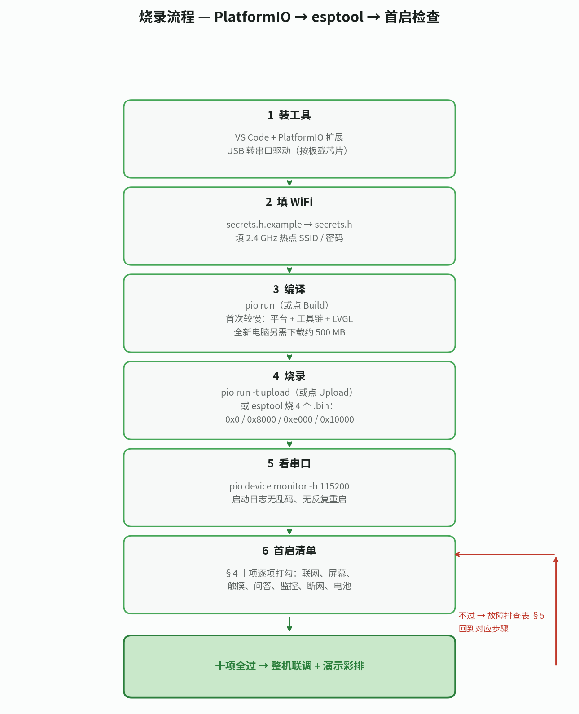

# 司稼小机器人 RV0.1.0 — 烧录与首启指南

> 对应方案：`robot/versions/v0.1.0.md`（§3 软件、§4 流程）。组装见 `ASSEMBLY.md`。
> 工程位置：`firmware/rv0.1.0/`（PlatformIO 工程，Arduino + LVGL）。
> 烧录前先确认：硬件已按 `ASSEMBLY.md` §4 接好线，屏幕已点亮过一次（或至少接好待验证）。

---

## 1. 烧录前的准备

### 1.1 工具安装（只装一次）

| 工具 | 装什么 | 说明 |
|---|---|---|
| VS Code | 官网下载安装 | 编辑器 |
| PlatformIO IDE | VS Code 扩展市场搜 `PlatformIO IDE` 安装 | 第一次打开工程时会自动下载 ESP32 平台和工具链，需要联网，耐心等几分钟 |
| USB 转串口驱动 | 按核心板上的 USB 转串口芯片装 | 大多数电脑自带；如果插上 Type-C 后电脑认不出串口，按芯片型号装驱动（CH340 / CP210x / CH343 常见，以板载芯片丝印为准） |
| esptool（可选） | `pip install esptool`（新版也可用 `python -m esptool`，同一工具） | 只在“不用 PlatformIO、直接烧 .bin”时需要，见 §3 |

### 1.2 确认工程

打开 `firmware/rv0.1.0/` 文件夹，确认有：

- `platformio.ini`：默认环境是 S3（板型 `esp32-s3-devkitc-1`，Flash 16 MB + 8 MB PSRAM，分区 `default_16MB.csv`）；C3 环境是 `esp32-c3-devkitm-1`（Flash 4 MB、无 PSRAM，分区 `partitions_c3.csv`）。`board_upload.flash_size` 与 `board_build.flash_size` 两行都要有（S3 是 16MB、C3 是 4MB）——后者会被静默忽略，只设它无效
- `src/main.cpp`（主程序）
- `include/display_config.h`（屏幕配置：驱动、分辨率、引脚，见 `ASSEMBLY.md` §7）
- `include/lv_conf.h`（LVGL 配置，放在工程内即可被找到，不用拷进库文件夹）

注意：`platformio.ini` 的 `lib_deps` 当前用 `^` 浮动版本；本次编译实际解析到 LVGL 9.6.0、TFT_eSPI 2.5.43、ArduinoJson 7.4.3（见 `release/FLASH_INFO.txt`，PlatformIO 6.2.0 / espressif32 8.0.0 / Arduino core 3.3.12），定稿时把这三个版本钉死再重新编译，浮动版本是已知风险源。另：S3 上若启动日志里 PSRAM 显示 0 字节，在 `platformio.ini` 补 `board_build.arduino.memory_type = qio_opi` 与 `board_build.flash_mode = qio` 两行后重新编译（**编译进行中时不要改**）；C3 没有 PSRAM，不看这项。

### 1.3 填 WiFi 账号密码（烧录前必须做）

机器人要联网调正式站接口，烧录前先把 WiFi 配好。**RV0.1.0 只有一种配网方式：烧录前在代码里填**（没有开机配网模式）：

- 在 `include/` 下把 `secrets.h.example` 复制为 `secrets.h`，填 SSID 和密码，再编译烧录。演示用**手机热点**（校园网有网页认证，单片机过不了，见方案 §6）。

注意事项：

- ESP32-S3 和 ESP32-C3 都只支持 **2.4 GHz WiFi**，不要连 5 GHz 频段；手机热点请开 2.4 GHz（或双频合一）。
- **不要把真实 WiFi 密码提交到公开仓库**：填密码的配置文件不要 `git add` 进去；演示用的热点密码也不要写进参赛材料。
- 首次开机会把账号存进 NVS，之后联网只读 NVS（见 §8）：换热点要整片擦除重烧，改 `secrets.h` 重烧不管用；首次烧录前先填好真实账号再开机。
- 演示现场提前一天用同一个热点全流程彩排一遍。

### 1.4 Mac / Windows 区分（只列不一样的地方）

| 不一样的地方 | macOS | Windows |
|---|---|---|
| 串口号 | `/dev/cu.usbserial-*`（CP210x 是 `/dev/cu.SLAB_USBtoUART`，CH340 是 `/dev/cu.wchusbserial*`） | `COM3`、`COM4` 这类 |
| 查串口号 | `ls /dev/cu.*`，或 `pio device list` | 设备管理器 → 端口，或 `pio device list` |
| USB 转串口驱动 | 按芯片装厂商驱动；装完要在 系统设置 → 隐私与安全性 里允许加载 | 按芯片装厂商驱动；设备管理器里有黄色感叹号就是没装好 |
| 装 esptool | `pip3 install esptool`，命令用 `esptool.py` 或 `python3 -m esptool` | `py -m pip install esptool`，命令用 `esptool` 或 `py -m esptool` |
| PlatformIO 快捷键 | 编译 `Cmd+Option+B`，上传 `Cmd+Option+U`，串口监视器 `Cmd+Option+S` | 编译 `Ctrl+Alt+B`，上传 `Ctrl+Alt+U`，串口监视器 `Ctrl+Alt+S` |
| PlatformIO 目录 | `~/.platformio` | `%USERPROFILE%\.platformio` |
| 中文路径 / 用户名 | 默认 UTF-8，路径含中文一般也没事 | 中文 Windows 下，路径里任何一段含中文（如 `C:\Users\中文用户名\...`、TEMP 文件夹）都可能触发 GBK 解码报错，见 §5；Mac 没有这个问题 |

其余相同：VS Code 里点 Build/Upload/Serial Monitor 的流程、串口监视器波特率 115200 都一样。不同的是 §2 的环境选择、§3 的 esptool 芯片与 Flash 大小、§4 清单第 1 项（PSRAM），下面各节 C3/S3 分开写。

### 1.5 先分清你手里是哪块板子（C3 / S3 对照）

| 项 | ESP32-S3（默认，登仕唐 N16R8） | ESP32-C3（过渡版，合宙 LuatOS 等） |
|---|---|---|
| 环境名 | `esp32-s3-n16r8`（`platformio.ini` 的默认环境） | `esp32-c3-devkitm-1`（烧录必须加 `-e`，见 §2.1） |
| Flash | 16 MB | 4 MB |
| PSRAM | 8 MB（LVGL 双缓冲放 PSRAM，40 行） | 无（显存双缓冲改 20 行放内部 RAM，滑动比 S3 卡一点，属正常） |
| 核心 | 双核 | 单核（网络任务不 pin 核） |
| OTA 自动更新 | 有（见 §8） | 无（单 app 分区；升级靠 USB 重烧，见 §9） |
| 分区表 | `default_16MB.csv`（ota_0 / ota_1 + otadata） | `partitions_c3.csv`（单 app，app0 约 2.9MB） |
| BOOT 键 | GPIO 0 | GPIO 9 |
| 引脚 | 见 `display_config.h` S3 一节 / `ASSEMBLY.md` §4.1 S3 表 | 见 `display_config.h` C3 一节 / `ASSEMBLY.md` §4.1 C3 表 |

---

## 2. 用 PlatformIO 烧录（推荐）

流程见 。

### 2.1 步骤

1. 用 Type-C 线把核心板连电脑（**只连核心板**，18650 模块先不要接）。
2. VS Code 打开 `firmware/rv0.1.0/` 文件夹，等 PlatformIO 初始化完成（左下角出现 PlatformIO 图标）。
3. 选环境（先看 §1.5，分清手里的板子）：
   - S3：左下角选 `esp32-s3-n16r8`（默认就是）。
   - C3：左下角选 `esp32-c3-devkitm-1`。
   - ⚠ 注意：左下角状态栏只管显示，Upload 任务可能仍跑 `platformio.ini` 里的默认环境。实测：状态栏已切到 C3，跑起来的命令仍是 `platformio.exe run --target upload`（不带 `-e`），结果按 S3 固件往 C3 板上烧，报错 `This chip is ESP32-C3, not ESP32-S3. Wrong chip argument?`。最可靠的办法是走下面命令行显式加 `-e`，跑完先核对终端第一行命令里有没有 `--environment esp32-c3-devkitm-1`。
4. 点左侧 PlatformIO 图标 → `Build`（Windows 按 `Ctrl+Alt+B`，Mac 按 `Cmd+Option+B`），等编译成功（平台与工具链已下载好时首次编译约 2–5 分钟；全新电脑首次打开工程另需下载约 500 MB，弱网可达十几分钟。以后增量编译很快）。
5. 点 `Upload`（Windows 按 `Ctrl+Alt+U`，Mac 按 `Cmd+Option+U`），等“上传成功”。C3 务必用下面命令行确认环境（见第 3 步的注意）。
6. 点 `Serial Monitor`（Windows 按 `Ctrl+Alt+S`，Mac 按 `Cmd+Option+S`），波特率 **115200**，看启动日志。

也可以用命令行（在工程目录下）：

```bash
# S3（默认环境：不加 -e 就是 S3）
pio run                 # 编译
pio run -t upload       # 烧录
# C3（必须加 -e，否则仍按默认的 S3 编译烧录）
pio run -e esp32-c3-devkitm-1                 # 编译
pio run -e esp32-c3-devkitm-1 -t upload       # 烧录
pio device monitor -b 115200   # 看串口日志（S3/C3 通用）
```

### 2.2 烧录不进下载模式怎么办

大多数开发板会自动进入下载模式。如果 Upload 一直报 `Failed to connect` / `Timed out waiting for packet header`：

1. 按住核心板上的 **BOOT** 键不放（S3 是 GPIO 0，C3 是 GPIO 9）；
2. 按一下 **RESET** 键（或拔插一下 Type-C）；
3. 松开 RESET，再松开 BOOT；
4. 重新点 Upload。

还不行：换一根数据线（有些线只能充电不能传数据）、换个 USB 口、把波特率降到 115200（`platformio.ini` 里 `upload_speed` 改 115200）。

C3 另外注意：如果触摸的 T_CS 线接在 IO0 上，板子可能进不了下载模式——先把 T_CS 线拔掉再烧（只针对 `Failed to connect`，与 §5 的 GBK 报错无关）。

---

## 3. 直接用 esptool 烧 .bin（不用 PlatformIO 时）

编译后 .bin 文件在工程目录的 `.pio/build/<环境名>/` 下（环境名，不是板名）：S3 是 `.pio/build/esp32-s3-n16r8/`，C3 是 `.pio/build/esp32-c3-devkitm-1/`。`boot_app0.bin` 例外：它不在编译输出目录里，在 PlatformIO 框架包里（见下表，S3/C3 共用同一份文件）。

| 文件 | 烧录地址（ESP32-S3：bootloader 在 0x0） | 位置 |
|---|---|---|
| `bootloader.bin` | `0x0` | `.pio/build/esp32-s3-n16r8/`（C3 是 `.pio/build/esp32-c3-devkitm-1/`） |
| `partitions.bin` | `0x8000` | 同上 |
| `boot_app0.bin` | `0xe000` | 框架包 `~/.platformio/packages/framework-arduinoespressif32/tools/partitions/boot_app0.bin`（Windows 是 `%USERPROFILE%\.platformio\packages\…\boot_app0.bin`） |
| `firmware.bin` | `0x10000` | `.pio/build/esp32-s3-n16r8/`（C3 是 `.pio/build/esp32-c3-devkitm-1/`，约 2.0MB） |

> C3 的四个文件与上表地址相同（bootloader 0x0、partitions 0x8000、boot_app0 0xe000、firmware 0x10000），区别是：文件在 `.pio/build/esp32-c3-devkitm-1/` 下；`partitions.bin` 来自单 app 分区表 `partitions_c3.csv`（无 OTA 分区，app0 约 2.9MB）；`firmware.bin` 约 2.0MB。

> `boot_app0.bin` 是 PlatformIO / Arduino IDE 每次上传都会自动带上的小文件（8 KB）：分区表含 OTA 分区时，bootloader 靠它在 otadata 为空时选默认 app，缺了全新擦除后可能无法启动。PlatformIO 点 Upload 时会自动烧它，手动用 esptool 烧时必须自己从框架包里取出来加上。
>
> ⚠ 注意：合并镜像必须含 `boot_app0`。`release/` 里当前的合并镜像（S3 `sijia-rv0.1.0-merged-16MB.bin`、C3 `sijia-rv0.1.0-c3-merged-4MB.bin`，2026-11-09 11:40 重做，OTA 地址改 main）都已含 `boot_app0`（0xe000 处已验证有数据）。自己按 §3.2 重新合并时不要漏了它——早期 01:43 的 S3 合并镜像是 3 个文件合并的，0xe000 处全是 0xFF（没含 boot_app0），全新擦除（`erase_flash`）后不要直接烧它，先按 §3.2 重新合并（含 boot_app0），或按 §3.1 分开烧 4 个文件。

### 3.1 四个文件分别烧

```bash
# 串口号见 §1.4（Mac 是 /dev/cu.usbserial-*，Windows 是 COMx，Linux 是 /dev/ttyUSB0 或 /dev/ttyACM0）
# 烧不进时把 --baud 921600 改成 115200
# Windows 上把下面命令里的 esptool.py 换成 esptool 或 py -m esptool（见 §1.4）

# S3：
esptool.py --chip esp32s3 --port <串口> --baud 921600 \
  write_flash 0x0 bootloader.bin 0x8000 partitions.bin 0xe000 boot_app0.bin 0x10000 firmware.bin

# C3（四个文件在 .pio/build/esp32-c3-devkitm-1/ 下；地址与 S3 相同）：
esptool.py --chip esp32c3 --port <串口> --baud 921600 \
  write_flash 0x0 bootloader.bin 0x8000 partitions.bin 0xe000 boot_app0.bin 0x10000 firmware.bin
```

### 3.2 合并成一个整体烧录文件（推荐发给别人烧录时用）

```bash
# 先把 boot_app0.bin 从框架包拷到工程目录（或在下面命令里写它的绝对路径）
# 合并（地址和上面一致；--flash_size 16MB 对应 N16R8 的 16 MB Flash）
# --flash_mode qio：N16R8 是 Quad Flash + Octal PSRAM 的正确组合；启动失败时改 dio 重试
esptool.py --chip esp32s3 merge_bin -o sijia-rv0.1.0-merged-16MB.bin \
  --flash_mode qio --flash_freq 80m --flash_size 16MB \
  0x0 bootloader.bin 0x8000 partitions.bin 0xe000 boot_app0.bin 0x10000 firmware.bin

# 只烧这一个文件，地址 0x0
esptool.py --chip esp32s3 --port <串口> --baud 921600 \
  write_flash 0x0 sijia-rv0.1.0-merged-16MB.bin

# C3 合并（--flash_size 4MB；--flash_mode dio）：
esptool.py --chip esp32c3 merge_bin -o sijia-rv0.1.0-c3-merged-4MB.bin \
  --flash_mode dio --flash_freq 80m --flash_size 4MB \
  0x0 bootloader.bin 0x8000 partitions.bin 0xe000 boot_app0.bin 0x10000 firmware.bin

# 只烧这一个文件，地址 0x0
esptool.py --chip esp32c3 --port <串口> --baud 921600 \
  write_flash 0x0 sijia-rv0.1.0-c3-merged-4MB.bin
```

说明：

- merge 参数以本节为准（`platformio.ini` 里没写 flash_mode / flash_freq，不要按它反推）。
- 烧完校验一次：`esptool.py --chip esp32s3 --port <串口> verify_flash 0x0 sijia-rv0.1.0-merged-16MB.bin`（C3 把芯片换成 `esp32c3`、文件换成 `sijia-rv0.1.0-c3-merged-4MB.bin`）；换版本前先备份整片 Flash：S3 是 `esptool.py --chip esp32s3 --port <串口> read_flash 0x0 0x1000000 backup-YYYYMMDD.bin`，C3 是 `read_flash 0x0 0x400000 backup-YYYYMMDD.bin`，再 `erase_flash`。
- 整块擦除（换版本、换工程前建议做一次）：`esptool.py --chip esp32s3 --port <串口> erase_flash`（C3 把芯片换成 `esp32c3`），再按上面烧。
- 合并好的整体烧录文件随版本发布时放在 `release/` 目录下，文件名注明版本和 Flash 大小（例如 S3 是 `sijia-rv0.1.0-merged-16MB.bin`，C3 是 `sijia-rv0.1.0-c3-merged-4MB.bin`），拿到就能烧；中间构建的四个单文件不单独提交，只提交合并镜像。
- 注：四文件烧录首次实机（11-10 到货后）验证一次能否正常启动再定稿。

---

## 4. 首启检查清单（烧完按顺序打勾）

> 第 1 项 C3/S3 不同，其余 9 项相同。

| # | 检查项 | 通过标准 |
|---|---|---|
| 1 | 串口日志 | 115200 波特率下能看到启动日志，没有乱码，没有反复重启。S3：日志里 PSRAM 为 8388608 字节（8MB），若显示 0 字节见 §5“白屏”一行；C3：没有 PSRAM，不看这项（显存 20 行放内部 RAM，滑动比 S3 卡一点属正常） |
| 2 | WiFi 联网 | 日志显示 WiFi 已连接，拿到 IP 地址（手机热点页面也能看到设备在线） |
| 3 | 健康自检 | 串口显示 WiFi 已连 + 拿到 IP；顶栏显示“在线”（启动时 `/api/health` 检查通过）或“服务器不通”（WiFi 通但正式站不通，查正式站 / 接口）。注意：固件只在启动时测一次 health，运行中 WiFi 重连后不再重测，顶栏可能误标“在线”（已知局限，见 §5） |
| 4 | 屏幕显示 | 亮屏，显示首页“司稼”标题 + 预设问题按钮；标题中文正常显示（方框 = 字库问题，见 §5） |
| 5 | 触摸 | 点预设问题按钮有反应；点屏幕四角，触摸位置对得上 |
| 6 | 问答 | 点“拖拉机发动机启动困难怎么办”，先显示“正在诊断…”，约 15–20 秒出答案；点开“查看依据与核对项”能展开来源 |
| 7 | 追问 | 再问一句，能出答案（多轮对话正常） |
| 8 | 监控页 | 左右滑动到监控页，三个表盘（水温 / 机油压力 / 转速）有数值，趋势图有曲线；页面标着“模拟数据 / 仿真监测” |
| 9 | 断网提示 | 关掉手机热点，顶栏变“离线”，监控页显示“离线，显示上次数据” |
| 10 | 18650 供电 | 拔掉 USB，改 18650 模块供电，整机正常开机、问答一次不重启（电流见 `ASSEMBLY.md` §6） |

全部通过 = RV0.1.0 首启完成，可以进整机联调和演示彩排。

---

## 5. 故障排查表

| 现象 | 可能原因 | 处理 |
|---|---|---|
| **烧不进**：`Failed to connect` / 超时 | 串口号不对；数据线只能充电；没进下载模式；驱动没装 | ① 确认串口号（见 §1.4：Windows 设备管理器 / Mac `ls /dev/cu.*` / 通用 `pio device list`）；② 换根能传数据的线；③ 按 §2.2 手动进下载模式（按住 BOOT + RESET；BOOT 键 S3 是 GPIO 0，C3 是 GPIO 9）；④ 装 USB 转串口驱动；⑤ 波特率降到 115200；⑥ C3 专用：T_CS 线接在 IO0 上时先拔掉再烧（见 §2.2） |
| **烧录报错 `This chip is ESP32-C3, not ESP32-S3. Wrong chip argument?`** | 命令跑的是默认 S3 环境，芯片对不上 | 状态栏显示的环境不作数：终端显式跑 `pio run -e esp32-c3-devkitm-1 -t upload`，跑完核对命令里有 `--environment esp32-c3-devkitm-1`（见 §2.1）。能认到芯片型号说明线、驱动、串口都没问题，不用换线重装驱动 |
| **Windows 报错 `UnicodeDecodeError: 'gbk' codec can't decode byte 0x88...`** | 中文 Windows 下 Python 按 GBK 解码输出，链路里任何一段路径含中文就可能触发 | ① 先确认工程完整路径：终端输 `Get-Location`，文件夹名没中文不等于路径没中文，`C:\Users\中文用户名\...`、TEMP 文件夹里含中文也算；② 永久设置环境变量 `PYTHONUTF8=1` 与 `PYTHONIOENCODING=utf-8`（PowerShell：`[System.Environment]::SetEnvironmentVariable('PYTHONUTF8','1','User')`，同理设 `PYTHONIOENCODING` 为 `utf-8`），彻底关掉重开 VS Code 再烧；③ 或把工程移到纯英文路径，如 `C:\sijia\rv0.1.0`，VS Code 打开新位置再烧。注意：终端里输 `$env:PYTHONUTF8=1` 只对当前那一个终端有效，`Ctrl+Alt+U` 会另起 shell，变量带不过去。Mac 默认 UTF-8，没有这个问题 |
| **上电串口全 blank、反复重启约几十次/秒** | Flash 大小错配（`board_build.flash_size` 会被静默忽略） | 查 `platformio.ini` 里 `board_upload.flash_size` 是否与板子一致（S3 是 16MB，C3 是 4MB）；两行都要有（见 §1.2） |
| **黑屏**：什么都不显示 | 背光没亮；供电不够；复位脚没接好；驱动不对 | ① 看背光亮不亮（LED 引脚：S3 是 GPIO 21，C3 是 GPIO 1，接好没）；② 换 USB 供电排除电池模块问题；③ 查 RST 接线（S3 是 GPIO 14，C3 是 GPIO 3）；④ 核对驱动丝印是不是 ILI9341（见 `ASSEMBLY.md` §2） |
| **`tft.init()` 处重启 / Guru Meditation（`StoreProhibited`）（仅 S3）** | S3 上 TFT_eSPI 默认 SPI 口与 Flash 冲突（Arduino core >2.0.14 常见） | `include/tft_setup.h` 加 `#define USE_HSPI_PORT` 再试；不行就把 Arduino core 降到 2.0.14 |
| **花屏**：有显示但颜色乱、条纹 | SPI 频率太高；驱动型号不对；线太长 / 接触不良 | ① `display_config.h` 里 SPI 频率从 40 MHz 先降到 10 MHz 验证（40 MHz 是超数据手册标称的超频常用值，见 `ASSEMBLY.md` §4.1），确认屏体质后再逐步上调；② 核对驱动丝印；③ 杜邦线换短的、插紧 |
| **白屏**：亮了但没有内容 | LVGL 没跑起来；初始化失败 | 看串口日志：卡在哪一步。S3：检查 `lv_conf.h` 和 PSRAM 配置（8 MB PSRAM 版，显存放 PSRAM）；PSRAM 显示 0 字节时在 `platformio.ini` 补 `board_build.arduino.memory_type = qio_opi` 与 `board_build.flash_mode = qio` 后重新编译。C3 没有 PSRAM：显存 20 行放内部 RAM，不看 PSRAM |
| **触摸没反应** | T_CS / T_IRQ 接错；触摸和屏幕 CS 搞混 | ① 核对接线表（S3：T_CS 是 GPIO 15，TFT_CS 是 GPIO 10；C3：T_CS 是 GPIO 0，TFT_CS 是 GPIO 10，别接反，见 `ASSEMBLY.md` §4.1）；② 串口看有没有触摸中断 |
| **触摸不准**：点 A 位置跑到 B | 没标定；XPT2046 标定参数不对 | ① 先确认触摸旋转与显示旋转一致：固件 `touch_cb` 按 rotation 1 横屏做映射，轴反了 / 镜像了交换映射的两行或取反（见 `main.cpp` 注释），不要另调库的 `setRotation`（会与现有映射叠加）；② 改 `display_config.h` 里的 `TOUCH_X_MIN/MAX`、`TOUCH_Y_MIN/MAX`（点屏幕四角，看串口打印的原始值再填）；还不准就检查 T_DO / T_DIN 有没有接反 |
| **连不上 WiFi** | 连了 5 GHz；密码错；热点没开 2.4 GHz；信号弱 | ① 只连 2.4 GHz；② 重新核对 SSID / 密码；③ 手机热点开 2.4 GHz 频段；④ 把机器人放热点旁边再试 |
| **问答超时**（约 2 分钟仍无答案） | 网络不通；正式站波动；CDN 回源慢 | 单次请求 60 秒超时，失败重试 1 次，约 2 分钟仍无答案才判失败：① 串口看 HTTP 状态码（200 / 403 / 超时）；② 403 = 请求头带了 Origin，检查固件不要加 Origin 头；③ 手机浏览器打开 agridx.xyz 验证正式站本身通不通；④ 再失败显示提示，不编答案；点预设问题可再问一次 |
| **顶栏“在线”但问答失败** | 固件只在启动时测一次 health，WiFi 重连后不重测 | 看串口问答请求的 HTTP 状态码；重启机器人重新测 health |
| **频繁重启** | 供电不足（见 `ASSEMBLY.md` §6.4） | 串口找 `Brownout detector was triggered`（出现即先查电源，不要当成代码问题重烧）；换 USB 供电验证；降背光、降音量、换 ≥ 2A 模块 |
| **串口乱码** | 波特率不对 | 串口监视器设 115200；还乱码就检查 Type-C 线和驱动 |
| **中文显示方框** | 字库没烧进去 / 子集缺字 | ① 确认字库文件在工程里且编译进去了；② 先验证首页标题“司稼”与顶栏“司稼 · 智能运维”正常显示；③ 缺的字补进 `lv_font_conv` 子集重新生成（见方案 §3.6） |
| **监控页没数据** | 遥测接口不通；WiFi 断了 | ① 看串口日志里 telemetry 请求的状态码；② 断网时显示上次数据是正常的；③ 浏览器打开正式站验证接口 |
| **滑动卡顿 / 帧率低** | SPI 频率低；显存不在 PSRAM；全屏重绘太多 | ① SPI 频率提到 40 MHz；② S3：确认 LVGL 双缓冲在 PSRAM；C3：显存只有 20 行内部 RAM 双缓冲，滑动比 S3 卡属正常，不是故障；③ 避免全屏大面积重绘（LVGL 只刷脏区域） |

---

## 6. 换件后要重做的检查（余量）

| 换了什么 | 要重做的事 | 固件要不要改 |
|---|---|---|
| 换屏幕（不同驱动 / 分辨率） | 改 `display_config.h`（驱动宏、宽高、旋转）→ 重新编译烧录 → 点亮验证 → 触摸校准 | **要**：改配置重新烧录（见 `ASSEMBLY.md` §7） |
| 换触摸芯片（XPT2046 → FT6236 / GT911） | 换驱动库、改 I2C 接线、改 `lv_indev` 注册 → 重新烧录 → 点四角验证 | **要**：改驱动和接线 |
| 换 18650 电池（2600 → 3400 mAh，或换 3C 电芯） | 只测续航和峰值电流（`ASSEMBLY.md` §6），跑一遍首启清单 §4 | **不用** |
| 换 18650 升压模块（更大输出电流） | 只测峰值电流和稳定性，跑一遍首启清单 §4 | **不用** |
| 换小喇叭（不同阻抗 / 功率） | 测音量和失真；4Ω 3W 以内直接换；阻抗不同时音量会变，以实测为准 | **不用**（调音量在 RV0.2.0 语音版里做） |
| 加 0.96 寸 OLED 副屏 | 按 `ASSEMBLY.md` §4.3 接 I2C（S3：SDA GPIO 8 / SCL GPIO 9，与 TFT_DC 撞脚，写 OLED 固件前先移到 GPIO 7；C3：SDA GPIO 12 / SCL GPIO 13）→ 烧录带 OLED 的固件 → 验证状态页 | **要**：固件里启用 OLED（U8g2，固件待写） |

---

## 7. 演示前一天：彩排清单

1. 用演示当天同一个手机热点，全流程跑一遍（§4 清单）。
2. 准备备用方案：热点打不开 → 换另一个手机热点；正式站波动 → 用提前录好的演示视频。
3. 电池充满电，备用一块满电 18650（或充电宝）放包里。
4. 带一根备用 Type-C 数据线、一包备用杜邦线。
5. 参赛材料里不要写 WiFi 密码、不要写仓库地址（按 PPT 规则）。

---

## 8. 联网自动更新（OTA，本版已有，S3 专用）

> 本节只适用 S3。C3 没有 OTA（单 app 分区，见 §9.3），C3 上的升级靠 USB 重烧。

> 演示现场改代码要重新插线烧录的日子过去了：机器人联网后会自动检查新版，有新版就自己下载、重启进新版，不用插线、不用人管。

### 8.1 怎么工作

- **WiFi 凭证存 NVS，不在固件里**：首次开机从 `secrets.h` 取 SSID/密码，存进 NVS（命名空间 `sijia`，键 `ssid` / `pass`）；以后联网一律读 NVS。OTA 升级只写 app 分区，绝不碰 NVS，升级后不断网。
- **版本检查**：联网后约 10 秒查第一次，之后每 24 小时查一次。查的是 main 上的 `version.json`：
  `https://raw.githubusercontent.com/srt2777/AgriDx/main/robot/firmware/rv0.1.0/version.json`
  内容示例：`{"version":"0.1.0","url":"https://…/release/firmware.bin","notes":""}`。版本号按数字分段比（0.1.10 > 0.1.9），远程比本地新才升级。
- **下载**：用 Arduino 自带的 HTTPUpdate，经 HTTPS 下载 `version.json` 里 `url` 指向的 `firmware.bin`，校验镜像无误才切换分区，成功后重启进新版。失败时顶栏恢复“在线”、界面提示“更新失败，继续使用当前版本”，下次检查再试，不死循环。
- **界面提示**：发现新版开始下载时，顶栏显示“更新中…”，并弹出“发现新版本，正在更新…”；下载成功重启，不需要人管。

### 8.2 发布新版的步骤

1. 改 `include/version.h` 里的 `FIRMWARE_VERSION`（如 `0.1.1`）。
2. 编译：`pio run`，产物在 `.pio/build/esp32-s3-n16r8/firmware.bin`。
3. 把 `firmware.bin` 传到 main 上的 `robot/firmware/rv0.1.0/release/firmware.bin`（.bin 不能走 API 推送，用浏览器上传）。
4. 更新 main 上的 `version.json`：`version` 改成新版本号，`url` 不变，`notes` 写改了什么。
5. 推送到 GitHub。已联网的机器人 24 小时内会自动检查到新版并升级。

> `version.json` 和固件 URL 都指向 main（2026-11-09 随 PR #235 合并后改过），设备查的就是 main 上的版本。

### 8.3 注意

- **换热点要整片擦除重烧**：改 `secrets.h` 再编译上传不会改 NVS 里已存的凭证（普通上传不擦 NVS）。换热点时先 `esptool.py --port <串口> erase_flash` 再按 §3 重烧，首次开机会重新从新的 `secrets.h` 取值存入 NVS。同样，首次烧录前必须先填好真实的 `secrets.h` 再开机——如果先用占位值（“你的WiFi名称”）开机，NVS 会存下占位值，之后再改 `secrets.h` 重烧也不生效，只能整片擦除。
- **没有自动回滚**：HTTPUpdate 会校验镜像（魔数、大小）才切换分区，但 Arduino 默认配置没有“新版起不来自动回滚旧版”。万一新版启动失败，只能 USB 重烧。**演示前不要发布新版 `version.json`**，避免演示现场正好赶上升级重启；演示前一天按 §7 彩排用的就是现场要跑的版本。
- **证书不校验（演示取舍）**：版本检查和固件下载都用 `WiFiClientSecure + setInsecure()`，不校验服务器证书。好处是演示环境省事；风险是中间人能冒充服务器下发固件（HTTPUpdate 只校验镜像格式，不验签名）。正式使用应改成校验根证书或给固件签名。
- **分区要求**：`default_16MB.csv` 自带 ota_0 / ota_1 + otadata，**不要换成单 app 分区表**，否则 OTA 没地方写新版。

---

## 9. ESP32-C3 过渡版（临时顶替 S3）

> 用户手头有个 C3，先拿它顶着用，S3 到了换回去。C3 只是 RV0.1.0 的一个编译变体，**不是新版本**，版本号、方案文件都不变。

### 9.1 编译

- S3（默认）：`pio run` 或 `pio run -t upload`。
- C3：`pio run -e esp32-c3-devkitm-1`，烧录：`pio run -e esp32-c3-devkitm-1 -t upload`。
- 板型默认 `esp32-c3-devkitm-1`；自己的板子不同就改 `platformio.ini` 里 `[env:esp32-c3-devkitm-1]` 的 `board` 这一行。
- 点 VS Code 里的 Upload 前，先核对终端命令里有没有 `--environment esp32-c3-devkitm-1`：只看左下角状态栏不可靠（见 §2.1 与 §5 的 `Wrong chip argument?` 一行）。

### 9.2 烧录

- Type-C 直连，C3 用 USB Serial/JTAG（CDC），PlatformIO 里点 Upload 就行；串口监视器同 115200。
- 大多数板子自动进下载模式；不行就按住 BOOT（GPIO9）不放，按一下 RESET，松开 RESET 再松开 BOOT，重新点 Upload。
- T_CS 线接在 IO0 上时可能进不了下载模式：先拔掉 T_CS 线再烧（见 §2.2 与 §5）。
- C3 是 4MB Flash：`firmware.bin` 约 1.9MB，app0 分区 2.9MB 放得下（见 `partitions_c3.csv`）。

### 9.3 C3 和 S3 不一样的地方

- **没有 OTA**：C3 分区是单 app，无 OTA 分区；OTA 代码在 C3 环境下编译关掉（`ENABLE_OTA=0`）。C3 上升级靠 USB 重烧。
- **没有 PSRAM**：显存双缓冲改 20 行放内部 RAM（S3 是 40 行放 PSRAM），滑动比 S3 卡一点，属正常。
- **单核**：网络任务不 pin 核；LVGL、触摸、WiFi、遥测逻辑不变。
- **引脚不同**：见下表，按自己的板子引脚图调整（改 `display_config.h` 的 C3 一节）。

### 9.4 C3 默认接线表（DevKitM-1 默认，按自己板子调整）

实测合宙 LuatOS ESP32-C3 核心板背面丝印的 IO 号与本表一致；其他 C3 板子按自己的引脚图核对。

| 信号 | C3 引脚 | 说明 |
|---|---|---|
| MOSI | 7 | 硬件 SPI2 默认脚 |
| MISO | 5 | 默认脚 GPIO2 是 strapping 脚，改用 5 |
| SCK | 6 | 硬件 SPI2 默认脚 |
| TFT_CS | 10 | 硬件 SPI2 CS0 默认脚 |
| TFT_DC | 4 | |
| TFT_RST | 3 | |
| TFT_BL | 1 | 背光 PWM |
| T_CS | 0 | 触摸片选 |
| T_IRQ | 11 | 触摸中断 |
| OLED SDA / SCL | 12 / 13 | I2C，任意 GPIO |

避开的脚：strapping（2/8/9）、USB D-/D+（18/19）、UART0（20/21）。

### 9.6 ESP32-C3 SuperMini + 0.96 寸 OLED（同一 agent 的另一个 C3 变体）

> 板子：ESP32-C3 SuperMini（22.52×18mm，ESP32-C3FN4，4MB Flash，无 PSRAM）。跑的还是同一个司稼 agent（POST /api/chat 问答 + 监测页），只是换了板子和屏。
> 屏定案：只用 0.96 寸 OLED，不接 3.2 寸 TFT——SuperMini 只引出 GPIO 0–10、20、21，现有 C3 TFT 环境的 MOSI/MISO/SCK 硬编码为 11/13/12（见 `include/tft_setup.h`），触摸中断 T_IRQ=11，这几个脚在 SuperMini 上根本没引出来；触摸一套要 9 个脚，可用非 strapping 脚只剩约 9 个，改线要重排全部引脚且无实测验证。RAM/Flash 本身不卡（C3 TFT 固件约 2.0MB、LVGL 部分缓冲 20 行仅 25.6KB 内部 RAM），卡的是引脚。

- 编译：`pio run -e esp32-c3-supermini-oled`；烧录：`pio run -e esp32-c3-supermini-oled -t upload`（Windows 与 Mac 命令相同；Mac 用 VS Code 终端里的 `pio`，见 §1.4）。
- 接线（0.96 寸 OLED，SSD1315，I2C 地址 0x3C）：

| 信号 | SuperMini 引脚 | 说明 |
|---|---|---|
| OLED VCC | 3V3 | 不要接 5V |
| OLED GND | GND | |
| OLED SDA | GPIO4 | 避开 strapping 脚 2/8/9 |
| OLED SCL | GPIO5 | 避开 strapping 脚 2/8/9 |
| BOOT 按键 | GPIO9（板载） | 短按翻页，长按 ≥800ms 问第一条预设问题 |

- 只烧 `firmware.bin` 到 0x10000（`esptool.py --chip esp32c3 --port <端口> write_flash 0x10000 firmware.bin`），不碰 NVS（0x9000），WiFi 不用重填。合宙 LuatOS 板的 12/13 接线不动，见 §9.4。
- 注意：SuperMini 没有 USB 转串口芯片，USB-C 直连芯片，串口监视靠 USB-CDC（环境里已开 `ARDUINO_USB_CDC_ON_BOOT=1` + `ARDUINO_USB_MODE=1`，只开前一个编不过）。

### 9.7 S3 到了换回去

换回 S3 环境重新编译烧录就行：`pio run -t upload`（默认就是 S3）。WiFi 账号存在 NVS 里，跟芯片走——换了芯片要重新填 `secrets.h`、整片擦除重烧一次（新芯片的 NVS 是空的，首次开机会重新从 `secrets.h` 取值存入，见 §8）。
