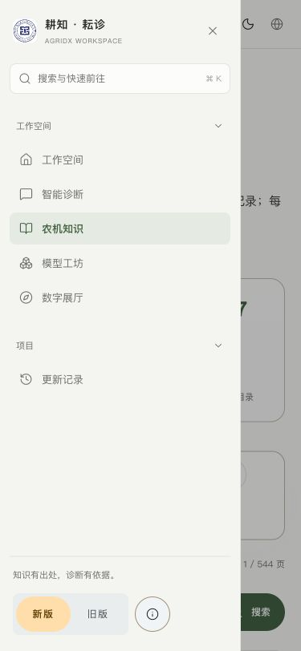

# UI 专区

本目录统一管理新旧版前端代码、静态资源、设计资料与界面测试。目录整理保持原有界面和交互。服务端、共享协议与知识库仍在仓库各自目录。

## 分类目录

| 目录 | 内容 |
| --- | --- |
| `src/pages/` | 新旧版页面和三维场景 |
| `src/components/` | 共用组件、基础控件和模型查看器 |
| `src/ui/` | 旧版外框、Radix 色阶和文案规则 |
| `src/styles/` 与 `src/*.css` | 全局样式、新版主题与动效 |
| `src/features/`、`src/hooks/`、`src/lib/` | 前端交互、状态和接口适配 |
| `public/` | 图片、模型、图标、主题初始化与资源许可 |
| `design/` | 设计参考、历史方案、验收截图 |
| `screenshots/` | 旧版改造验收截图 |
| `tests/` | 前端组件、布局与交互的自动检查 |
| `tools/` | 配色和展示模型生成工具 |
| `licenses/` 与 `src/ATTRIBUTIONS` | UI 依赖许可与署名 |

从仓库根目录运行原有 `npm run dev`、`npm run verify` 命令。`@/` 指向 `ui/src/`，静态资源的浏览器 URL 保持不变。混合前后端的集成测试保留在根目录 `tests/`。

## 文件

- [旧版外框](src/ui/WorkspaceShell.tsx)：侧栏、搜索、主题语言切换、手机抽屉。
- [布局](src/ui/workspace.css)和[视觉规范](src/ui/classic-system.css)：仅作用于旧版。
- [Radix 色阶](src/ui/radix-tokens.css)：来自 `@radix-ui/colors`，用 `node ui/tools/generate-colors.mjs` 重新生成。
- [文案规则](src/ui/copy.ts)：简化旧版界面文案；共享页面的新版文字不变，原始知识和版本日志不改写。
- [验证记录](VALIDATION.md)与[截图](screenshots/)。

## 设计约定

| 项目 | 本轮约定 |
| --- | --- |
| 文案 | 移除旧版界面中点；使用“农机知识”“设备信息”等常用名称；去掉重复说明 |
| 配色 | Radix Sage 中性色、Grass 强调色；Red 错误、Amber 警告、Blue 链接 |
| 色阶用途 | 1–2 底色、3–5 控件状态、6–8 边线与焦点、9–10 实色操作、11–12 文字 |
| 字号 | 12、14、24px 三档；以字重和间距表达层级 |
| 线条 | 需要时使用 0.5px；不使用卡片左侧彩色竖线 |
| 圆角和阴影 | 容器 8px、常规控件 4px；对齐嵌套间距；移除装饰阴影 |
| 动效 | 关闭旧版装饰性动画和过渡，减少动态设置始终生效；保留用户操作的模型查看 |
| 信息组织 | 常用功能直接进入；设备信息、资料边界、项目研究在相应位置展开，无新增确认步骤 |
| 新旧版隔离 | 旧版外框标记 `data-ui-version="old"`；所有配色与视觉覆盖限定在该外框 |

学院标识、说明书图片和三维模型保留原资源与署名，未把原始资料改写为界面配色或文案。语义色规范见 [Radix 官方用途说明](https://www.radix-ui.com/colors/docs/palette-composition/understanding-the-scale)和[配色组合](https://www.radix-ui.com/colors/docs/palette-composition/composing-a-palette)，许可证见 [MIT](licenses/radix-colors-MIT.txt)。

## 用户指定参考

- [Michael Filipiuk 侧栏整理](https://x.com/michaelfilipiuk/status/2113239967006855524)：已看部分视频画面，参考分组和视觉节奏。
- [Fluid Functionalism Sidebar](https://www.fluidfunctionalism.com/docs/sidebar?preset=sa1FQfCxG4)：参考文字导航、分组、轻选中态和手机抽屉；未移植源码，未加入拖动改宽或悬停预览。
- [Open Claude UI](https://openclaudeui.com/)：参考内容优先和控件层级，未使用其品牌或专有字体。最终色阶按用户后续要求统一为 Radix。

## 截图

旧版知识页：

旧版模型工坊：

手机导航与诊断：

新版保留核对：

